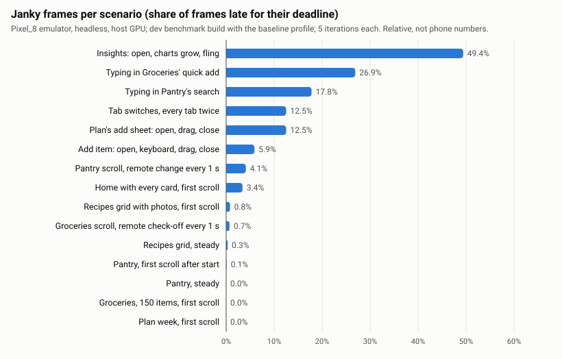

# 08 Smoothness and runtime performance

Reviewed `0334b6a` on 2026-11-02 (the branch `review/2026-11` at `333f76b`, which adds only review reports).
Platform: Android. Emulator numbers compare builds and screens on one Mac; they are **relative, not phone timings**.

**Setup.** Mac with an Apple M1 Pro (8 performance and 2 efficiency cores) and 16 GB, macOS 27.2, on battery (Low
Power Mode off), with Firefox and a Gradle daemon from an earlier session open (about 4.5 and up to 3.7 GB). Pixel_8:
Android 17 (API 37, 16 KB pages, Google Play image rev 6), emulator 37.2.12, 4 cores, **4 GB**: `-memory 2048` is
ignored for this image (the emulator logs "Increasing RAM size to 4096MB"). Firebase Auth and Firestore emulators
(`demo-spoilnot`) started from `firebase/` without import or export, so `firebase/.emulator-data` was never touched.

After the BASE-08 investigation below, every measurement ran on Pixel_8 started as

```bash
~/Library/Android/sdk/emulator/emulator -avd Pixel_8 -gpu host -feature -Uwb -no-window -no-snapshot -no-boot-anim -no-audio
```

with these checks before each run: `adb shell dumpsys SurfaceFlinger | grep GLES` names "Apple M1 Pro" (hardware
rendering), the `qemu-system-aarch64` process runs at macOS priority 31 (`ps -o pri -p <pid>`), and the guest's
one-minute load is under 2.5 (`settle.sh`, Appendix B). A monitor logged the Mac's free memory, swap and page-outs and
the guest's load every 20 s: the Mac stayed at 32 to 55% free memory and its swap at 2.2 to 4.4 GB (most of it from
the old commit's build), with one burst of page-outs (125 MB at 22:13, during the first remote-write Pantry run; the
repeat right after it, with no page-outs, gave the same result). The lid was closed twice (20:46–21:22 and from
22:29), which sleeps the Mac; the run that overlapped the first sleep (A3) was replaced, and every other run ended
before a sleep (`pmset -g log`).

**Data.** The emulator-only 500-batch household (`perf-500@example.com`, seeded by `PantryScrollPerfTest` as
`baseline-profile.sh` does). For the A/B, the startup budget and the profile regeneration it had only that, like every
earlier measurement. For the other screens `seed-perf-extras.cjs` (Appendix B) then added 150 grocery items in nine
aisles (30 in the cart), 40 recipes (20 with 2400 × 1800 JPEG photos served from the Mac at `10.0.2.2:8099`, which the
dev benchmark build may reach in clear text), three meals a day from last week to the week after next, six months of
Insights, 40 activity events and a second member.

**Method.** Macrobenchmark 1.5.0 against the dev benchmark build (release code, R8, debug-signed), always with the
committed baseline profile (`CompilationMode.Partial(Require)`) unless the row says "without". `StartupBenchmark` and
`PantryScrollBenchmark` as committed; everything else from a temporary class `Review08Benchmark` (Appendix A),
removed afterwards. Frame numbers are `FrameTimingMetric`'s frame CPU time; "jank" is the share of frames whose
`frameOverrunMs` is above 0 (late for their deadline). Remote changes were played by `remote-writer.cjs` (one write a
second from a second "member"). Traces were read with Perfetto's `trace_processor_shell` for arm64, which the benchmark
library already ships (`benchmark-common-1.5.0.aar`), run on the emulator itself; nothing was downloaded for it.
Compose compiler reports and metrics came from a Gradle init script in the scratchpad, recomposition counts from a
second init script that adds `androidx.compose.runtime:runtime-tracing` to the dev benchmark build only.

At the end the temporary class was deleted, the regenerated profile restored (`git restore`), the Firebase emulators
stopped with SIGINT (started without import or export, so `firebase/.emulator-data` is empty as it was), Pixel_8
stopped (`adb emu kill`), the image server, the monitor and the two Kotlin daemons this session's builds started
stopped, and the scratch worktree removed (`git worktree remove`, `git worktree prune`). On Pixel_8: the dev app
(which the connected runs uninstall) reinstalled from the dev debug APK and cleared, as it was found; the network
shaping reset; the Google app, which was force-stopped once, restarts on its own; animation scales, font scale and
developer settings were never changed. The old prod build on Pixel_8 was not touched. Launch flags only: the AVD's
files were not edited.

## Summary

**BASE-08 is settled, and it was the environment.** macOS throttles a windowed emulator whose window isn't in front
(App Nap, priority 4 instead of 31). Headless on the host GPU, the system Settings list drops from about 60 ms a frame
to 17 ms, and Spoil Not's first Pantry scroll from 59 ms to 4 ms. On that setup an A/B against `f737440` gives the same
first scroll for the old and the current build (P50 4.0 against 4.1 ms, 0% janky frames) and matches 2026-10-29. The
budgets hold on the emulator: cold start 345 ms to the first frame, 500 batches scroll with no janky frames. But the
startup benchmark stops at Home's skeleton; the cards come at 1.34 s, and the first sync already takes 1.7 s with no
network delay at all (PERF-05).

Lists scroll smoothly when nobody else is writing. The jank is elsewhere:

- **Every Firestore snapshot is mapped and turned into screen state on the main thread**, by up to five copies of
  the pantry pipeline (PERF-02, P2). One remote change costs ~75 ms of main-thread work and makes 4% of Pantry's
  scroll frames late; each key typed in Pantry's search costs ~26 ms.
- **Insights** misses the deadline on half its frames while the charts grow (PERF-03). Typing in Groceries' quick
  add misses 27% (PERF-04), tab switches and sheets 12.5% (PERF-09).
- **The baseline profile has never contained Add item:** its button has no text for the journey to find (A11Y-01).
  Regenerating now would drop the crash-report code prod runs at every start (PERF-06).

Memory is flat after the first round of tabs (no leak), and recipe photos are decoded at the card's size. 10 findings:
2 P2, 8 P3. No item had a security angle; nothing moved to the private notes.

## Metrics

All on Pixel_8 headless (setup E2 below), dev benchmark build with the committed baseline profile unless a row says
otherwise. **Emulator numbers are relative.** The Mac's M1 Pro runs this guest faster than a mid-range phone's CPU, so
a phone needs more time for the same work; the A/B and the differences between scenarios are what these numbers
are for.

### BASE-08 settled: the setup, step by step

Review 00 could not get stable numbers (cold start medians 1,089, 460 and 4,937 ms; first-scroll P50 49 to 98 ms
against 4.9 ms on 2026-10-29). Each step below changed one thing and was checked with a control that has nothing to
do with Spoil Not: the system **Settings** list, flung up and down six times, three runs, read with `dumpsys gfxinfo`
(`control.sh`, Appendix B). gfxinfo's percentiles include the wait for vsync, so 17 ms is "on time" at 60 Hz.

| Step | Pixel_8 launch | qemu priority | Settings P50 / P90 / P99 (3 runs) | Janky frames | Spoil Not first Pantry scroll, with profile |
| --- | --- | --- | --- | --- | --- |
| E0 | windowed, `-gpu host` (00's runs B and C) | **4** | 57–65 / 117–150 / 150–300 ms | 58–80% | P50 59.4, P90 158.2, P99 388.5 ms, **99.3%** janky (B0) |
| E1 | windowed, `-gpu host -feature -Uwb` | **4** | 48–69 / 101–150 / 200–550 ms | 71–73% | — |
| E2 | **headless**, `-gpu host -feature -Uwb -no-window` | **31** | **17 / 18–19 / 19–20 ms** | **3.3%** (all three) | P50 4.0, P90 5.4, P99 6.9 ms, **0.1%** janky (median of B runs) |

What the steps show:

1. **The renderer was not the problem this time.** In E0 the GPU really was the Mac's (`GLES: … Apple M1 Pro`), yet
   Settings, the lightest list on the phone, took 57 to 65 ms a frame.
2. **macOS was throttling the emulator.** A windowed `qemu-system-aarch64` started from this session ran at
   priority **4**, macOS's background tier, while every other process the session started (shell, Gradle, Node) ran
   at the normal 31. That is App Nap: the emulator is a GUI app whose window isn't in front. Headless, the same
   binary runs at 31 and the control drops from about 60 to 17 ms with 3.3% janky frames, the same in all three runs.
   It also explains why 00's runs got worse one after another while the window sat behind other windows. Started from
   Android Studio and watched, the window would be in front, which is likely how 2026-10-18 to 10-29 were measured.
3. **Inside a throttled guest the app competes for CPU.** In a B0 scroll trace (8.1 s, 4 cores), the app's
   RenderThread ran 2.19 s and **waited for a core 2.62 s**; the main thread ran 1.53 s and waited 1.95 s.
   SurfaceFlinger used about 5.3 s of CPU, the composer HAL 2.1 s, `crash_dump64` 0.37 s.
4. **Two smaller noise sources**, both removed by the launch line: the UWB service crash-loops every ~5 s on this
   image (each crash runs `crash_dump64`, which took a whole guest core for a moment and fills logcat, which adbd then
   streams to Gradle); `-feature -Uwb` turns the feature off and the loop stops. And the emulator raises the guest to
   4 GB whatever `-memory` says, so 00's "2 GB guest" idea isn't available with this image.
5. **Memory pressure on the Mac was not the cause this time.** The throttled and the quiet runs had similar free
   memory (about 40 to 50%) and no page-outs, apart from the one burst noted under Setup.

**The A/B against `f737440`** (2026-10-28, the commit that generated today's baseline profile), on setup E2, three
alternating runs each (old, new, old, new, …; the old build from a detached worktree in the scratchpad, built with
`ANDROID_HOME` and no copied config). One old run (A3) overlapped the Mac sleeping (lid closed 20:46–21:22) and was
replaced by A4.

| First Pantry scroll, frame CPU time | `f737440` (runs A1, A2, A4) | `0334b6a` today (runs B1, B2, B3) | 2026-10-29 (DESIGN 17) |
| --- | --- | --- | --- |
| With the baseline profile: P50 / P90 / P99, median of 3 runs | **4.0 / 5.3 / 7.4 ms** | **4.1 / 5.5 / 7.3 ms** | 4.9 / 7.1 / 28.3 ms with the new profile (5.3 / 8.0 / 19.0 with the one before) |
| Spread across the 3 runs | P50 3.9–4.1, P90 5.2–5.7, P99 6.5–11.0 | P50 4.0–4.1, P90 5.4–5.6, P99 6.5–7.6 | — |
| Janky frames (overrun > 0), median of runs (range) | 0.0% (0.0–0.9) | 0.0% (0.0–0.2) | — |
| Without the profile: P50 / P90 / P99, median of 3 runs | 4.5 / 6.6 / 9.9 ms | 4.3 / 6.6 / 9.0 ms | not recorded |
| Janky frames without the profile | 1.0% (0.8–1.6) | 1.0% (0.2–1.3) | — |
| Frames per run (6 flings × 5 iterations) | 450–496 | 469–510 | — |

**Verdict: environment, not the app.** The first Pantry scroll is as fast as on 2026-10-29 (P50 4.9 ms then, 4.0 ms
now) and the same as the old commit within run-to-run noise. Nothing in the 33 commits since `f737440` (crash reports
off in emulator builds, the tour fix, five library updates) slowed it. 00's 49 to 98 ms came from App Nap (and, in run
A, software rendering). One reading note: DESIGN 17's 2026-10-29 row compares the old profile with the regenerated
one (both with a profile); 00's table took the first pair for "without the profile".

### Budgets (DESIGN 13.1)

| Metric | Value | How measured | Target or budget |
| --- | --- | --- | --- |
| Cold start, first frame, with the profile | **345 ms** median of 3 runs (run medians 340, 359, 345; 30 iterations 253–419 ms) | `StartupBenchmark.startupWithBaselineProfile`, `timeToInitialDisplayMs`, 10 iterations × 3 runs | Under 2.5 s on a mid-range phone. Emulator history: 392 ms (2026-10-19), 623 ms (2026-10-31, software rendering) |
| Cold start, first frame, without the profile | **397 ms** median of 3 runs (393, 419, 397; 265–590 ms) | `…startupWithoutProfile` (the first iteration of each run is the signed-out welcome screen; without it: 404 ms) | — |
| What the profile saves at cold start | 13% (52 ms) | The two rows above | — |
| Cold start until Home shows its cards | **1.34 s** median (1.00–1.55 s, 10 iterations), while the first frame of the same starts came at 375 ms: Home shows its loading skeleton for about a second. Of the main thread's 258 ms of work up to the cards, 182 ms runs between frames (snapshot mapping and state building) | `Review08Benchmark.startupColdToHomeContent`: from launch until "Needs attention" is on screen, polled every 16 ms | Same 2.5 s (QA.md 4 times "until Home shows its cards") |
| Warm start, first frame | **68 ms** median (52–83 ms, 10 iterations) | `Review08Benchmark.startupWarm` | — |
| Hot start | **22 ms** median (13–37 ms, 10 iterations), from the launch intent to the first frame after `activityResume`, read from the traces: Macrobenchmark can't measure it here, because the platform logs a hot resume of this activity as "intent failed" (no launch) | `Review08Benchmark.startupHot` | — |
| First household sync, sign-in tap to Home's cards, empty cache | **1.74 s** median (1.71, 1.74, 1.81) | `Review08Benchmark.firstSyncAfterSignIn`: `pm clear`, sign in, poll for "Needs attention"; the household has 500 batches, 250 products, 150 grocery items, 40 recipes, 63 meals | Under 2 s on 4G. **This is a lower bound**: the Firestore emulator is on the same Mac, no network delay |
| First household sync to the first Pantry row | 1.83 s median (1.82–2.02) | Same, after opening Pantry (includes skipping the tour) | — |
| Same with the emulator's network set to LTE speed and 3G latency | 1.74 s median (1.24–2.03) | `adb emu network speed lte; network delay umts` | **Inconclusive**: no slower than without, so the shaping doesn't seem to reach traffic to `10.0.2.2`. QA.md measured 4.3 s on 2026-10-18 this way |
| First Pantry scroll, 500 batches, with the profile | **P50 4.1 / P90 5.5 / P99 7.3 ms, 0.0% janky** (median of 3 runs; runs 0.0–0.2%) | `PantryScrollBenchmark.firstScrollWithBaselineProfile`, frame CPU time, 6 flings × 5 iterations × 3 runs | 60 fps: 16.7 ms per frame |
| First Pantry scroll without the profile | P50 4.3 / P90 6.6 / P99 9.0 ms, 1.0% janky (0.2–1.3%) | `…firstScrollWithoutProfile` | — |

### Frames per scenario



Frame CPU time (main thread plus RenderThread per frame), percentiles over all frames of 5 iterations; janky = frames
whose `frameOverrunMs` is above 0, overall and the range across iterations; P99 overrun in ms (negative = on time with
room to spare). "First" starts the app fresh before each iteration; "steady" flings once before measuring.

| Scenario | Frame CPU P50 / P90 / P99 (ms) | Janky frames (per iteration) | Overrun P99 (ms) | Frames |
| --- | --- | --- | --- | --- |
| Pantry, first scroll after start (`PantryScrollBenchmark`, 3 runs pooled) | 4.1 / 5.5 / 7.3 | 0.1% (0.0–0.2% per run) | — | 1,497 |
| Pantry, steady (warmed by one pass) | 4.0 / 5.4 / 7.4 | 0.0% (0–0%) | −7.2 | 487 |
| Groceries, 150 items, first scroll | 4.1 / 5.7 / 7.5 | 0.0% (0–0%) | −6.0 | 538 |
| Groceries, steady | 4.0 / 5.5 / 7.5 | 0.0% (0–0%) | −6.7 | 539 |
| Recipes grid, 40 recipes, 20 photos, first scroll | 3.9 / 6.2 / 9.6 | 0.8% (0–4%) | −3.9 | 396 |
| Recipes grid, steady | 3.8 / 5.7 / 9.7 | 0.3% (0–1%) | −5.4 | 387 |
| Plan week, first scroll | 3.6 / 5.4 / 7.5 | 0.0% (0–0%) | −7.3 | 394 |
| Home with every card, first scroll | 3.6 / 6.2 / 25.7 | 3.4% (2–5%) | 12.0 | 208 |
| **Insights: open from Home, charts grow, fling, back** | **11.6 / 19.4 / 26.3** | **49.4% (40–79%)** | 19.6 | 644 |
| Tab switches, every tab twice | 3.6 / 15.6 / 20.2 | 12.5% (4–24%) | 9.7 | 1,275 |
| Add item: open, keyboard on Name, drag, close | 4.0 / 8.4 / 21.4 | 5.9% (3–9%) | 16.6 | 870 |
| Plan's add sheet: open, drag, close | 3.5 / 16.7 / 20.3 | 12.5% (5–33%) | 20.0 | 626 |
| **Typing "item 12" in Pantry's search** | 3.9 / 16.2 / 19.7 | **17.8% (7–27%)** | 22.0 | 354 |
| **Typing "item 12" in Groceries' quick add** | **7.7 / 18.8 / 34.7** | **26.9% (22–32%)** | 20.1 | 130 |
| **Pantry, steady, while another member changes a batch every second** | 4.1 / 5.8 / 8.3 | **4.1% (2–8%)** | **57.5** | 493 |
| Same, after opening Groceries first | 4.1 / 5.5 / 18.1 | 4.8% (1–15%) | 44.0 | 421 |
| Groceries, steady, while another member checks items off every second | 4.0 / 5.9 / 8.2 | 0.7% (0–1%) | −3.5 | 541 |

### Compose

| Metric | Value | How measured | Target |
| --- | --- | --- | --- |
| Strong skipping | On (Kotlin 2.4.21 compiler plugin); also intrinsic remember, pausable composition | `app-module.json` feature flags | — |
| Named composables | 209, of which 180 restartable, **all 180 skippable**; 29 not restartable (return a value or inline) | `app-composables.txt` | — |
| Composables with unstable parameters | **21** restartable ones (Pantry rows and status chip, Add item and Edit item sheets and fields, Add to pantry, Home cards, Insights month details, Plan header and add sheet), plus 5 non-restartable helpers. Every unstable parameter is a `java.time` type (`LocalDate`, `YearMonth`) except `rememberGrow(key: Any)`. Parameters typed with the domain classes (`item: PantryItem`, `item: GroceryItem`) are "runtime" and resolve to unstable through those classes | `app-composables.txt` | 0 |
| Unstable classes | 77 of 339 (ViewModels, exceptions and the like included). The list items: `StockBatch`, `Product`, `GroceryItem`, `Recipe`, unstable only through their `java.time` fields; both `UiState`s through `today: LocalDate` | `app-classes.txt` | — |
| Lazy lists without `contentType` | **All 4** (Pantry, Groceries, the Recipes grid, Plan's days). It matters for Pantry and Groceries, which mix headers and rows; Recipes and Plan have one item type | Reading | — |
| `key` on lazy items | All lazy items and sticky headers have keys | Reading | — |
| Sorting or filtering in composables | 3 places: Groceries' quick-add suggestions (`GroceriesScreen.kt:148`), `productsWithStock` for Add item (`PantryScreen.kt:187`), Plan's recipe id set per day card (`PlanScreen.kt:288`); everything else is in ViewModels or `domain` | Reading | — |
| State read higher than needed | `listState.isScrollInProgress` in `PantryList`'s composition; the Home skeleton's and Insights charts' animation values in composition | Reading | — |
| Recompositions per scroll (6 flings), Pantry row | **0** state-driven recompositions of `PurchaseRow` or `StatusChip`, quiet or with a remote change every second (Pantry holds updates while scrolling); 18–22 compositions of rows scrolling in, **all in prefetch** (off the frame), ~0.9 ms each | Composition tracing (`runtime-tracing` and the Perfetto SDK library added by an init script), `pantryScrollSteady` and `pantryScrollRemote`, 2–3 iterations each; a run under `Recomposer:recompose` counts as a recomposition (`recompose.sql`) | — |
| Recompositions per scroll, the list itself (`PantryList`) | **7** quiet (one per fling start or stop, from reading `isScrollInProgress`), **10–13** with remote changes (each snapshot re-runs it, with its 500-batch `flatMap`), 0.4 ms each | Same | — |

### Main thread at cold start (one start with the profile, 345 ms to first frame), and garbage collection

| Part | Time | Notes |
| --- | --- | --- |
| `bindApplication` | 116 ms (100–123 over three traces) | Of which opening the app's DEX and OAT 45 ms (platform), Firebase initialization **29 ms** (Crashlytics `fire-cls` 15.5, Sessions 6.7, FCM 3.3, core 3.3), the app's own `onCreate` with Hilt at most ~30 ms (not traced separately) |
| `activityStart` | 13 ms | `MainActivity.onCreate` 8 ms |
| `activityResume` | 62 ms | The first composition of the app happens here (the splash screen holds the frame) |
| First frames | ~120 ms over 5 frames | One waits 46.5 ms on RenderThread (first draw) |
| Main thread blocked on disk (state D) before the first frame | 17–29 ms | Mostly page faults while opening the APK and OAT |
| Binder calls on the main thread before the first frame | 46 calls, 22–28 ms | Normal platform calls; none from the app's code stood out |
| Disk or network work by the app on the main thread | None seen | DataStore, SharedPreferences (`SyncLog`) and Firestore set-up run off the main thread or lazily |
| Garbage collection | None during a quiet Pantry scroll; **149 ms of GC-thread work** (plus 98 ms reference queue) in a 3 s scroll with one remote change a second; under 1 ms while Insights opens | `HeapTaskDaemon` running time in the traces (`gc.sql`) |

### Memory

| Metric | Value | How measured | Target |
| --- | --- | --- | --- |
| Total PSS after start, after round 1, after round 10, after 5 s idle | **110 → 136 → 145 → 134 MB** (rounds 2 to 10: 133–147 MB) | `Review08Benchmark.memoryAfterTenRounds`: each round opens Pantry, Plan, Groceries, Recipes and Home with one fling each, then Insights; `dumpsys meminfo` after each round | Flat after warm-up |
| Java heap / native heap | 46 / 29 MB at start; 41–54 / 49–61 MB from round 2 on; 42 / 54 MB after idle | Same | — |
| Activities, views, app contexts | 1, 15, 7 throughout | Same | No growth |
| Native heap growth from the 20 recipe photos (2400 × 1800 JPEG) | About 28 MB in round 1, then flat | Same; a full-size decode would be about 17 MB per photo | Coil decodes at the card's size (`SubcomposeAsyncImage` with `ContentScale.Crop`, no `size(ORIGINAL)`) |
| Verdict | **No leak seen**: memory rises in the first round (caches, images, every tab's ViewModel and listeners) and stays level | — | — |

### Baseline profile

| Metric | Value | How measured | Target |
| --- | --- | --- | --- |
| Committed profile | 17,054 rules, generated at `f737440` (2026-10-28), unchanged since | `git log` | Current |
| Regenerated today on the same data | 16,807 rules; **1,682 only in the fresh profile, 1,929 only in the committed one** (10% churn), app code 1,141 against 1,166 rules | `./scripts/baseline-profile.sh`, `comm` of the sorted files; restored with `git restore` | — |
| Journey covers | Start, sign-in, Home, Insights, Pantry, Plan and its add sheet, Groceries, Recipes. **Add item never opens** (its button has no text to find, A11Y-01); not visited: recipe detail, cook mode, Edit item, Add to pantry, quick add, Settings | `BaselineProfileGenerator`, `AppDriver.kt`; no `AddItemForm`, `DateChips` or `ExpiryField` code in either profile | — |

## Findings

### PERF-01 · P2 · Confirmed · Android tooling — A windowed emulator is throttled by macOS, so benchmarks ran ten times too slow and drifted (BASE-08's cause)

- **Where:** RUNBOOK "Baseline profile"; `scripts/baseline-profile.sh`; how Pixel_8 is started for any timing.
- **What happens:** started with a window that isn't in front, the emulator process runs at macOS's background
  priority (4 instead of 31, App Nap). A typical frame in the guest then takes about 50 to 70 ms, even in the system
  Settings list, and results depend on what else is on the screen, so runs drift. Headless (`-no-window`) it runs at
  full priority, and both the control and Spoil Not match the 2026-10-29 numbers run after run. RUNBOOK and the
  script don't say how to start the emulator and check nothing. Smaller traps met on the way: the UWB service
  crash-loops on this image, the emulator ignores `-memory 2048`, `AppDriver.type` (`input text`) dropped characters
  on the busy guest so sign-in failed, `tests_regex` with `|` or `(` runs zero tests (AGP passes it through the device
  shell unquoted), and a closed lid sleeps the Mac mid-run.
- **Evidence:** the BASE-08 table (E0 to E2) and the A/B in Metrics; `ps -o pri` 4 against 31; the throttled
  trace's RenderThread waiting 2.62 s for a core in 8.1 s.
- **Who it affects:** the owner and every session that measures or regenerates the baseline profile; the after-fix
  rerun of 00 and 08.
- **Suggested fix:** a "Benchmark setup" paragraph in RUNBOOK with the launch line from the Setup paragraph above,
  and a preflight in `baseline-profile.sh` that refuses to run on SwiftShader (`dumpsys SurfaceFlinger | grep GLES`),
  warns when the emulator process's priority is under 31, and waits for the guest's load to settle; `UiObject2.setText`
  instead of `input text` in `AppDriver` (Ideas). Effort S. Also needs: DESIGN 13.1's sentence on the benchmarks,
  QA.md section 4's "measured on" line, a DESIGN 17 row that records the corrected baseline.

### PERF-02 · P2 · Confirmed · Android — Every snapshot is mapped and turned into screen state on the main thread, by up to five copies of the pantry pipeline, two of which never stop

- **Where:** no `flowOn` anywhere in the app; `core/firebase/DeltaSync.kt:115-140` (`liveDocuments`) and
  `FirestoreFlows.kt` (listeners registered without an executor call back on the main thread);
  `feature/pantry/data/FirestorePantryRepository.kt:36-46`; `PantryViewModel.kt:102-123,128-137`;
  `GroceriesViewModel.kt:112-136,250-264`; `HomeViewModel.kt:97-143`; `PlanViewModel.kt:147`.
- **What happens:** for each change to `products` or `stock` (another member's edit, this phone's own write and its
  acknowledgement), each observer of `pantry.observe` maps every document again (250 products and 500 batches, with a
  tombstone check each), compares the result with the last one, and builds its screen state: Pantry builds its groups
  twice (`PantryItems.build`, and `PantryItems.all` only to know whether the pantry is empty), Groceries rebuilds its
  aisles and scans the products per item for Back in stock, Home rebuilds the dashboard and Use it up. All of it runs
  on `Dispatchers.Main.immediate` (`viewModelScope`), between frames, so frames start late. Pantry, Groceries, Home,
  Plan and the restock engine each run their own copy (the engine on `Dispatchers.Default`). Because Pantry's and
  Groceries' ViewModels collect their own flows from `init` (empty-batch clean-up, "someone added"), their copies keep
  running after the first visit, with the tab hidden. The same happens for each key typed in Pantry's search.
- **Evidence:** traces, main thread, in the measured window:

  | Scenario | Main-thread work outside frames | Longest burst | Janky frames |
  | --- | --- | --- | --- |
  | Pantry scroll, nobody else writing | 53 ms | 1.1 ms | 0.0% |
  | Pantry scroll, one remote change a second (3 in the window) | **213 and 245 ms** (two iterations), so **~70–80 ms per change** | 15.7 ms | 4.1% (2–8%), overruns to 57 ms |
  | Typing 7 keys in Pantry's search | **182 ms**, ~26 ms per key | 16.5 ms | 17.8% |
  | Cold start until Home's cards | 182 ms | 10.5 ms | — |

  Garbage too: during the quiet scroll the app's GC thread (`HeapTaskDaemon`) did no work; with one remote change a
  second it ran 149 ms (and `ReferenceQueueDaemon` 98 ms) in the same window, from the objects each re-mapping
  allocates.

  Pantry holds the visible update while scrolling (DESIGN 6.4), so the rows don't move; the frames still drop. This
  is on the Mac's M1 Pro; a mid-range phone needs two to four times longer for the same work, which would make each
  remote change a visible hitch.
- **Who it affects:** households with a few hundred batches whenever someone else is changing things (the shopping
  trip, Add to pantry on the other phone), and anyone searching the pantry.
- **Suggested fix:** `.flowOn(Dispatchers.Default)` on the repositories' mapping and on the ViewModels' state builds
  (the domain code is pure already); one shared pantry flow per household (a `@Singleton` holder with
  `shareIn(…, WhileSubscribed)`) used by every ViewModel and the restock engine; `conflate()` before each state
  build; the two `init` collectors moved onto that shared flow; `PantryItems.all` computed once. Effort M. Also needs:
  DESIGN 9.8 (one listener pair per collection and phone), section 09's listener count, a unit test that the state
  build runs off the main dispatcher.

### PERF-03 · P3 · Confirmed (emulator) · Likely smaller on phones · Android — Insights stutters while its charts grow: every frame re-lays out the screen and redraws the stripes line by line

- **Where:** `feature/insights/ui/InsightsCharts.kt:61-66` (`rememberGrow` returns `progress.value`, read in
  composition), `:195-196` (the bar's height in a size modifier), `:203-213` (`stripedRect`, one `drawLine` per
  stripe), `:115` (dashed ring).
- **What happens:** opening Insights grows the ring, the six months' bars and the reason bars over 700 ms. The
  animation value is read in composition, so all three charts recompose on each frame, and because a bar's height is
  a layout size, each frame also measures and lays out the whole scrolling column. Each frame then redraws every
  thrown-away stripe as its own line (about 80 per reason bar) and the dashed ring. On the emulator the GPU can't keep
  up: the RenderThread spends 8.1 ms per frame drawing against 2.4 ms on Pantry, waits for a free buffer 48 times at
  13.5 ms each, and compiles 13 shaders the first time.
- **Evidence:** `insightsOpenAndScroll` in Metrics: frame CPU P50 11.6, P90 19.4, P99 26.3 ms, **49% janky frames**
  (40–79% per iteration), against 0–3% on every list; RenderThread table from the trace (Appendix B, `rt.sql`).
- **Who it affects:** anyone opening Insights, for its first second. How much of this a phone's GPU absorbs is the
  open part: the relayout and the per-stripe drawing are the app's; the buffer waits are mostly the emulator's (phone
  check 5).
- **Suggested fix:** read the animation in the draw phase (pass `{ progress.value }` and draw the bar's height in
  `drawBehind`, or `graphicsLayer { scaleY = … }` with the origin at the bottom), so nothing re-lays out; draw stripes
  once with `drawWithCache` (a cached `Path` or an `ImageShader` brush); keep the dashed ring's `PathEffect` in the
  cache too. Effort S. Also needs: Insights' screenshot tests unchanged (the final frame is the same).

### PERF-04 · P3 · Confirmed · Android — Groceries redraws every visible row on any change, computes suggestions in composition, and moves rows under the finger

- **Where:** `feature/grocery/ui/GroceriesScreen.kt:175-205` (`GroceryRow(item, state, …)`), `:366` and `:383` (the
  row reads `state.backInStock`, `state.myUid`, `state.memberNames`), `:148` (quick-add suggestions computed in
  composition), `GroceriesViewModel.kt:117-136`.
- **What happens:** each row gets the whole `UiState`, which is new on every emission (any item, the pantry, a name),
  so every visible row recomposes on every change; the state also carries the whole pantry only for Back in stock and
  the suggestions. The suggestions are recomputed in composition on every recomposition of the screen, normalizing
  each product and item name up to four times per key typed, and the first suggestion opens a popup window (21 ms of
  composition and 9 binder calls in one frame). With no hold while scrolling (CODE-09), another shopper's check-off
  moves the row to In cart at once, with `animateItem` sliding the rows under the finger.
- **Evidence:** typing "item 12" in quick add: frame CPU P50 7.7, P90 18.8, P99 34.7 ms, **27% janky** (22–32%),
  the longest frame being the popup; scrolling with a remote check-off every second stays smooth on the emulator
  (0.7% janky, 92 ms of main-thread work outside frames against 53 quiet) because a list of 150 items is cheap to
  map. The row movement isn't something frame timing shows: phone check 2.
- **Who it affects:** two people shopping from one list, the case the app is built around; slow phones most.
- **Suggested fix:** pass rows what they show (`backInStock: Boolean`, `addedBy: String?`) computed in the ViewModel;
  suggestions in the ViewModel from a `text` flow, off the main thread; Pantry's hold as a shared helper (CODE-09).
  Effort S–M. Also needs: the web port (section 10); a test that a remote check-off during a drag doesn't move the
  list.

### PERF-05 · P3 · Confirmed · Android — The startup budget is measured at the skeleton; Home's cards come a second later, and the first sync is near its budget even with no network delay

- **Where:** `benchmark/.../StartupBenchmark.kt` (`timeToInitialDisplayMs` only); no `reportFullyDrawn` or
  `ReportDrawnWhen` anywhere in the app; DESIGN 13.1, QA.md 4.
- **What happens:** the benchmark stops at the first frame after the splash screen (345 ms), which is Home's loading
  skeleton. The cards a person waits for came at **1.34 s** median (1.00–1.55 s) on the emulator. Both are under
  2.5 s here, but only the first is measured, and the gap is where PERF-02's main-thread work sits. The first
  household sync (empty cache, sign-in tap to Home's cards) took **1.74 s** with the Firestore emulator on the same
  machine, so no network delay at all; on 4G, with several round trips before data arrives (sign-in, profile,
  membership, then the collections), 2 s isn't reachable. QA.md measured 4.3 s on 2026-10-18 under a slow profile.
  The emulator's own network shaping didn't slow traffic to the Mac (`10.0.2.2`), so this review couldn't repeat
  that measurement.
- **Evidence:** Budgets in Metrics; `startupColdToHomeContent` and `firstSyncAfterSignIn` (Appendix A).
- **Who it affects:** everyone at every start (a second of skeleton), and every new phone or member at sign-in.
- **Suggested fix:** `ReportDrawnWhen { state is loaded }` on Home so Android and Macrobenchmark record time to full
  display, and the budget measured on that (`timeToFullDisplayMs`); PERF-02's fixes shorten the gap. For the first
  sync, decide with the owner whether 2 s on 4G is the right budget (DESIGN 13.1) or what "sync" means (Home's cards
  versus every collection). Effort S. Also needs: DESIGN 13.1 and QA.md 4 (which number is the budget), phone
  check 3.

### PERF-06 · P3 · Confirmed · Android — The committed profile is from `f737440`, its journey never opens Add item, and regenerating now would drop the crash-report path prod runs

- **Where:** `app/src/main/baselineProfiles/baseline-prof.txt` (17,054 rules, unchanged since 2026-10-28);
  `benchmark/.../AppDriver.kt:124-126` (`openAndCloseAddItem` taps `By.text("Add item")`);
  `BaselineProfileGenerator.kt`; `core/firebase/FirebaseCrashReporting.kt` (#70).
- **What happens:**
  - **Add item is missing.** The floating button's text isn't in the accessibility tree (A11Y-01), so the
    journey's `By.text("Add item")` finds nothing and the step silently does nothing. Neither the committed nor a
    fresh profile has any of the Add item form's code (`AddItemForm`, `DateChips`, `ExpiryField`): the most-used
    sheet runs without precompiled code (interpreted, then JIT) until the phone's background compilation catches
    up. (This review's own Add item scenario failed the same way until it found the button by role and position.)
  - **Library updates made part of it stale.** Regenerated today on the same data: 16,807 rules, 1,682 only in the
    fresh profile, 1,929 only in the committed one (10%). The app's own code barely moved (1,141 against 1,166
    rules); the churn is DataStore 1.2.1 → 1.3.0 (76 rules for its old protobuf classes are dead, 61 for the new
    `DataStoreImpl` missing), the Firebase BoM update (Firestore, gRPC) and Compose internals.
  - **A trap for the next regeneration.** Since #70 the emulator builds no longer send crash reports or Sessions, so
    the generator no longer runs the upload code. A fresh profile has 93 rules for
    `com/google/android/datatransport` against 233, and 223 against 282 for Firebase Sessions. Prod builds run that
    code at every start (`fire-cls` and `fire-sessions` take 22 ms of the main thread at start even in the emulator
    builds), so committing a fresh profile as is would make it slower for real users.
  - Not in the journey either: recipe detail, cook mode, Edit item, Groceries' Add to pantry, quick add.
- **Evidence:** the profile counts above; `git diff --numstat` 1682 / 1929 (the regenerated file was restored with
  `git restore` and isn't committed); the failed and fixed Add item scenario (Appendix A, `openAddItem`).
- **Who it affects:** everyone, a little: the first Add item after each install or update is slower than it needs to
  be; the A/B shows the rest is fine today.
- **Suggested fix:** find the button by its test tag (turn on `testTagsAsResourceId` in benchmark builds) or by
  description once A11Y-01 gives it one, and fail the journey when a step doesn't open what it should instead of
  skipping it; add the missing flows; keep the crash-report path with a small hand-written rules file next to the
  generated one (AGP merges every file in `baselineProfiles/`); regenerate after dependency updates as well as after
  UI changes (RUNBOOK). Effort S. Also needs: RUNBOOK "Baseline profile", a DESIGN 17 row with before and after
  numbers measured on PERF-01's setup.

### PERF-07 · P3 · Confirmed (compiler report) · Likely (effect) · Android — `java.time` fields make every list item class unstable, so each snapshot recomposes every visible row

- **Where:** `feature/pantry/domain/PantryModels.kt:105-121` (`StockBatch`: `expiryDate`, `openedOn`,
  `createdAt`), `Product`, `GroceryItem`, `Recipe` (`createdAt: Instant?`); both ViewModels' `UiState`
  (`today: LocalDate`).
- **What happens:** strong skipping is on, so unstable parameters are compared by identity. These four classes are
  unstable only because `LocalDate` and `Instant` aren't known to be immutable, and each snapshot maps every document
  into new objects, so every visible row and its status chip recompose on every emission even when nothing in them
  changed. 21 restartable composables take a `java.time` parameter directly.
- **Evidence:** the Compose compiler report (Metrics; `app-classes.txt`: "unstable class …StockBatch { unstable val
  expiryDate: LocalDate? unstable val createdAt: Instant? unstable val openedOn: LocalDate? }"). During a scroll
  Pantry's hold hides it (0 row recompositions in the traces, Metrics); it applies when a change lands while the
  list is still, which the traced windows didn't contain.
- **Who it affects:** everyone, a little, on each remote change (on top of PERF-02).
- **Suggested fix:** a stability configuration file (`composeCompiler { stabilityConfigurationFiles }`) listing
  `java.time.*`; data classes then skip by `equals`. Effort S. Also needs: a DECISIONS entry.

### PERF-08 · P3 · Confirmed · Android — Small composition costs in the lists: no `contentType`, scroll state read in composition, work redone on every recomposition

- **Where and what:**
  - **No `contentType`** in Pantry's list (`PantryScreen.kt:268-320`: the expired header, sticky headers, purchase
    and "out" rows) or Groceries' (`GroceriesScreen.kt:167-205`: aisle headers, the cart header, rows). Lazy lists
    reuse a scrolled-off slot only for the same content type; without one, a header can take a row's slot.
  - **`listState.isScrollInProgress` read in composition** (`PantryScreen.kt:252`, the hold for remote changes): the
    whole `PantryList` recomposes when every fling starts and stops, and each time it runs
    `shown.flatMap { it.items }.filterIsInstance<…>().map { it.batch }` over all 500 batches for
    `rememberRemoteChanges` (`:254-259`). Reading it in a `snapshotFlow` inside the effect avoids both.
  - **Per-row setup:** each Pantry and Groceries row creates an `Animatable`, a `LaunchedEffect` and its own
    `rememberReduceMotion()` for the remote highlight (`RemoteChanges.kt:65-80`), plus a swipe state and a reset
    effect.
  - **Plan:** `recipeIds = state.recipes.mapTo(HashSet()) { it.id }` is built inside `items {}` for each day card on
    each composition (`PlanScreen.kt:288`), a new set each time, so every day card recomposes with the list.
  - **Home's loading skeleton** reads its infinite animation's `.value` in composition (`HomeScreen.kt:466-475`), so
    it recomposes every frame while Home loads, during PERF-05's second of skeleton.
  - **Add item:** `productsWithStock` (500 batches filtered) is computed in `PantryScreen`'s composition while the
    sheet is open (`PantryScreen.kt:187`).
- **Evidence:** composition traces: `PantryList` recomposes 7 times per 6 flings when quiet and 10–13 times with a
  remote change a second (Metrics); the rest by reading. Pantry and Groceries scroll at 0% janky frames on the
  emulator, so none of these shows alone here.
- **Who it affects:** slow phones, where they add up.
- **Suggested fix:** one small PR: `contentType` on every `item`, `items` and `stickyHeader`; the hold read through
  `snapshotFlow`; the remote-change list remembered by `shown`; the recipe id set remembered once; the skeleton's
  alpha in `graphicsLayer`; `productsWithStock` in the ViewModel. Effort S.

### PERF-09 · P3 · Confirmed (emulator) · Android — Tab switches and sheets drop frames while a screen is composed for the first time inside a fading transition

- **Where:** `core/navigation/AppShell.kt:311-317,377-382` (the shared-axis transition with fades), every tab's
  screen; `feature/plan/ui/PlanSheets.kt:94` (Plan's add sheet).
- **What happens:** each tab switch composes the new tab's screen from scratch during the 250 ms slide and fade.
  The fade draws both screens into offscreen layers each frame, which the RenderThread flushes (101 layer flushes in
  one iteration, up to 20.7 ms), and the first frame of a screen also compiles shaders. Opening Plan's add sheet has
  two long frames for its first composition. Add item with the keyboard is lighter.
- **Evidence:** tab switches 12.5% janky (4–24% per iteration), P90 15.6 ms; Plan's sheet 12.5% (5–33%); Add item
  with keyboard and drag 5.9% (3–9%), P99 21.4 ms; traces: 3 long main-thread frames per tab round, the rest
  RenderThread (layer flushes, buffer waits, 7 shader compiles).
- **Who it affects:** everyone, slightly, on every tab switch; mostly GPU-bound on the emulator, so the phone check
  decides how visible it is.
- **Suggested fix:** keep tab screens composed across switches (or at least their lists' state) so a switch only
  animates; consider a short fade without the slide (or no transition) for tab switches, keeping the shared axis for
  push and pop. Effort M. Also needs: DESIGN 6.4 (motion between tabs).

### PERF-10 · P3 · Confirmed · Android + docs — Motion has no tokens, two of DESIGN 6.4's motions don't exist, and reduce motion is read once

- **Where:** `core/designsystem/motion/` (only `ReduceMotion.kt`); `core/navigation/AppShell.kt:377-382`;
  `core/ui/RemoteChanges.kt`; `feature/insights/ui/InsightsCharts.kt:64`; `feature/home/ui/HomeScreen.kt:469-475`.
- **What happens:**
  - Durations and easings are literals where they're used: 250 ms slide and fade-in (the fade-in delayed 50 ms),
    150 ms fade-out, 120 ms with reduce motion, 700 ms chart growth, 800 ms skeleton pulse, 1,500 ms remote highlight.
    All fit 6.4's "200 to 300 ms standard easing" except the 150 and 120 ms fades, but nothing keeps the next one
    consistent: the package named `motion` holds no motion.
  - 6.4 lists "container transform from a row to its detail" and "a spring on check-off". Neither exists: a Pantry row
    opens an Edit sheet, a recipe card a shared-axis screen; check-off is a haptic tick and the row jumps to In cart
    with `animateItem`'s default placement spring (or fades out when the cart is folded). A doc fix unless the owner
    wants them.
  - `rememberReduceMotion()` is `remember(context) { … }`: it reads "Remove animations" once per call site, so turning
    it on with the app open changes nothing on screens already shown. Compose's own animations follow the system scale
    anyway.
  - Haptics match 6.4: a light tick on check-off, a long-press buzz on every swipe-dismiss.
- **Evidence:** the files above; the sheet and tab numbers in Metrics.
- **Who it affects:** nobody today; the next screen's author.
- **Suggested fix:** a small `Motion` object in `core/designsystem/motion` (durations, easings, the shared-axis spec,
  the highlight) used by the call sites above; DESIGN 6.4 rewritten to what the app does or the two motions built;
  `rememberReduceMotion` observing the setting. Effort S.

## Ideas

- **Keep the jank scenarios.** Appendix A's class could stay as a `JankBenchmark` (Groceries, Recipes, Plan, Insights,
  tab switches, Add item with the keyboard, typing, scrolling under remote changes), with `seed-perf-extras.cjs`
  turned into an instrumented seed next to `PantryScrollPerfTest`. Every finding above can then be checked after its
  fix the same way.
- **Type with `setText`, not `input text`.** `UiObject2.setText` goes through accessibility and can't drop keys, so
  sign-in in the benchmarks stops failing on a busy device.
- **Measure on the owner's phone once.** Macrobenchmark runs on a USB phone with the dev benchmark build and
  `-Pspoilnot.emulatorHost=<LAN IP>` (00's idea); one run of `PantryScrollBenchmark`, `StartupBenchmark` and the
  Insights scenario would turn this report's relative numbers into absolute ones.
- **A startup profile.** `BaselineProfileRule.collect(…, includeInStartupProfile = true)` also writes a startup
  profile that R8 uses to lay out the DEX, which usually takes a few percent off cold start. Cheap once PERF-06 is done.
- **Keep benchmark results** (00's idea, still valid): copy each run's `*benchmarkData.json` to a dated folder; this
  review's A/B needed exactly that.

## For other sections

- **07 Accessibility:** A11Y-01's nameless floating buttons also break UI automation. The profile journey's
  Add item step finds nothing and skips (PERF-06), and a UiAutomator test can only find the button by role and
  position. Fixing A11Y-01 fixes both.
- **09 Efficiency:** two ViewModels keep their Firestore listeners attached for as long as the activity lives, also
  with their tab hidden and the app in the background. `PantryViewModel` collects `data` from `init` for
  `deleteEmptyBatches`, and `GroceriesViewModel` collects `state` for "someone added", which defeats their
  `WhileSubscribed(5_000)`. Together with the restock engine that's three `products` + `stock` listener pairs that
  never detach after Pantry and Groceries were opened once; Home and Plan re-attach their own pair after 5 s away.
- **05 Reliability / 04 Sync:** snapshot callbacks and mapping run on the main thread with no conflation, so a burst
  (Add to pantry on another phone, a restore) is processed snapshot by snapshot and can fall behind on a slow phone.
- **10 Web:** not measured here; Groceries' "whole state to every row" pattern and the Insights charts' growth
  animation are worth the same look in React.
- **11 Code:** `StartupBenchmark`'s KDoc says "under 2 s" (DESIGN 13.1 says 2.5 s; 00 noted it); DESIGN 17's
  2026-10-29 row compares two profiles, not "without and with" as 00 read it; QA.md section 4's "measured on" line and
  DESIGN 17's benchmark rows don't name the emulator setup.

## Not covered

- **Real phones.** Every number here comes from the Pixel_8 emulator on the owner's Mac and is relative; the phone
  checks below give absolute ones.
- **App Nap as the mechanism.** The evidence is the priority (4 windowed, 31 headless) and the fourfold difference
  with everything else equal. A windowed run with the window kept in front wasn't possible from this session (no
  screen control), so that variant is untested.
- **First sync on a real network.** The emulator's speed and latency shaping didn't slow traffic to `10.0.2.2`, so
  1.74 s is a zero-latency lower bound; 4G is phone check 3.
- **Headless software rendering** (2026-10-31's setup) wasn't rerun: headless with the host GPU was stable, and
  RUNBOOK needs one setup.
- **Hot start through Macrobenchmark:** it can't see a hot resume of this activity on this image ("intent failed");
  the 22 ms is read from the traces instead.
- **Prod release builds**, by the ground rules; the dev benchmark build is the same release code with names kept.
- **The web app** (section 10) and **battery and background work** (section 09).
- **Dark mode, preset themes and 200% text** while scrolling: not measured; nothing in the code makes them costlier.
- **A regenerated profile's effect** on the numbers wasn't measured (it would have needed a rebuild with the fresh
  profile; PERF-06 says why it shouldn't be committed as is).

## Phone checks for the owner

Note the phone model and Android version once in the Result column. Developer options: Settings > About phone, tap
Build number seven times. Turn Profile HWUI rendering off again at the end.

| # | Phone | Steps | Expected | Result |
| --- | --- | --- | --- | --- |
| 1 | Android | Developer options > Profile HWUI rendering > "On screen as bars". Right after a cold start, open Pantry and fling to the bottom and back twice; then once more. | Bars stay under the green line (16 ms) almost always; a few spikes on the very first pass are fine. Write how many bars cross the line per pass. | |
| 2 | Android | Bars on. Open Groceries on a long list and fling down and up twice. Then have someone check items off on their phone while you scroll, and separately edit a few pantry items while you scroll Pantry. | Same as Pantry when alone. With the other phone: write whether bars spike when their change arrives (PERF-02) and whether Groceries' rows jump under your finger (PERF-04, CODE-09). | |
| 3 | Android | Cold start three times: swipe Spoil Not away in Recents, wait 10 s, tap its icon, time from the tap until Home's cards show (not the splash, not the grey placeholders). Then once on mobile data (Wi-Fi off): Settings > sign out, sign in, time until Home's cards show. | Each cold start under 2.5 s (DESIGN 13.1). The sign-in on mobile data: under 2 s is the budget (PERF-05). Write all four times. | |
| 4 | Android | Pantry > Add item: watch the sheet open, tap Name (the keyboard opens), drag the sheet down a little and let go, close it. The same with Plan's add sheet. Switch between all five tabs quickly. Type a few letters in Groceries' "Add an item" and in Pantry's search. | No stutter when the keyboard or a sheet opens, when tabs switch, or while typing. Note any. | |
| 5 | Android | Bars on. Home > See insights, watch the charts grow, scroll down and back. Then open it again. | Note whether the bars cross the line while the charts grow (PERF-03), the first time and the second. | |

## Appendix A: the temporary benchmark class (removed after the run)

Lived at `benchmark/src/main/kotlin/com/parcha/spoilnot/benchmark/Review08Benchmark.kt` during the review. It uses
`AppDriver.kt` as committed. Run one method at a time (a `tests_regex` with `|` or `(` runs nothing, PERF-01):

```bash
./gradlew :benchmark:connectedBenchmarkAndroidTest "-Pandroid.testInstrumentationRunnerArguments.class=com.parcha.spoilnot.benchmark.Review08Benchmark#insightsOpenAndScroll"
```

```kotlin
package com.parcha.spoilnot.benchmark

import android.os.SystemClock
import android.util.Log
import androidx.benchmark.macro.BaselineProfileMode
import androidx.benchmark.macro.CompilationMode
import androidx.benchmark.macro.ExperimentalMetricApi
import androidx.benchmark.macro.FrameTimingMetric
import androidx.benchmark.macro.MacrobenchmarkScope
import androidx.benchmark.macro.MemoryUsageMetric
import androidx.benchmark.macro.Metric
import androidx.benchmark.macro.StartupMode
import androidx.benchmark.macro.StartupTimingMetric
import androidx.benchmark.macro.junit4.MacrobenchmarkRule
import androidx.test.ext.junit.runners.AndroidJUnit4
import androidx.test.uiautomator.By
import androidx.test.uiautomator.BySelector
import androidx.test.uiautomator.Direction
import androidx.test.uiautomator.Until
import org.junit.Rule
import org.junit.Test
import org.junit.runner.RunWith

/**
 * Review 08 (temporary, removed after the review): warm and hot start, scrolling and interactions beyond Pantry,
 * and memory after visiting every tab ten times. All with the baseline profile, as the shipped app runs. The data
 * is the 500-batch perf household plus `seed-perf-extras.cjs` (150 grocery items, 40 recipes, a full plan).
 */
@OptIn(ExperimentalMetricApi::class)
@RunWith(AndroidJUnit4::class)
class Review08Benchmark {
    @get:Rule
    val rule = MacrobenchmarkRule()

    private val profile = CompilationMode.Partial(BaselineProfileMode.Require)

    @Test
    fun startupWarm() = startup(StartupMode.WARM)

    @Test
    fun startupHot() = startup(StartupMode.HOT)

    private fun startup(mode: StartupMode) = rule.measureRepeated(
        packageName = TARGET_PACKAGE,
        metrics = listOf(StartupTimingMetric()),
        compilationMode = profile,
        startupMode = mode,
        iterations = 10,
        setupBlock = {
            grantPermissions()
            pressHome()
        },
    ) {
        startActivityAndWait()
        signInIfNeeded()
    }

    /** Cold start until Home shows a card's content, not only the first frame (no reportFullyDrawn in the app). */
    @Test
    fun startupColdToHomeContent() = rule.measureRepeated(
        packageName = TARGET_PACKAGE,
        metrics = listOf(StartupTimingMetric()),
        compilationMode = profile,
        startupMode = StartupMode.COLD,
        iterations = 10,
        setupBlock = {
            grantPermissions()
            // Sign in once (a fresh install is signed out); Macrobenchmark kills the app before each cold start.
            startActivityAndWait()
            signInIfNeeded()
            pressHome()
        },
    ) {
        // Signed in already (the first test run signs in); no helper waits here, only polling for Home's first card.
        val start = SystemClock.uptimeMillis()
        startActivityAndWait()
        val launched = SystemClock.uptimeMillis() - start
        val shown = waitFor(By.textContains("Needs attention"), 15_000)
        Log.i(TAG, "homeContentMs=${SystemClock.uptimeMillis() - start} launchedMs=$launched shown=$shown")
    }

    /**
     * DESIGN 13.1's first household sync: the app's data is cleared (no Firestore cache), then sign in; logged is the
     * time from the Sign in tap until Home shows its cards and until Pantry shows its first row.
     */
    @Test
    fun firstSyncAfterSignIn() = rule.measureRepeated(
        packageName = TARGET_PACKAGE,
        metrics = listOf(StartupTimingMetric()),
        compilationMode = profile,
        startupMode = StartupMode.COLD,
        iterations = 3,
        setupBlock = {
            device.executeShellCommand("pm clear $packageName")
            grantPermissions()
            pressHome()
        },
    ) {
        startActivityAndWait()
        device.wait(Until.findObject(By.clickable(true).hasDescendant(By.text("Sign in"))), 20_000)?.click()
        device.wait(Until.findObject(By.text("Email")), 20_000)?.click()
        device.executeShellCommand("input text perf-500@example.com")
        device.wait(Until.findObject(By.text("Password")), 20_000)?.click()
        device.executeShellCommand("input text correct-horse-battery")
        device.pressBack()
        val signIn = device.wait(Until.findObject(By.clickable(true).hasDescendant(By.text("Sign in"))), 20_000)
        val start = SystemClock.uptimeMillis()
        signIn?.click()
        val home = waitFor(By.textContains("Needs attention"), 30_000)
        val homeMs = SystemClock.uptimeMillis() - start
        skipTourIfShown()
        openTab("Pantry")
        val row = waitFor(By.textStartsWith("Item "), 30_000)
        Log.i(TAG, "firstSync homeMs=$homeMs home=$home pantryMs=${SystemClock.uptimeMillis() - start} row=$row")
    }

    @Test
    fun pantryScrollSteady() = scroll("Pantry", warmUp = true)

    @Test
    fun pantryScrollRemote() = scroll("Pantry", warmUp = true, iterations = 5)

    @Test
    fun pantryScrollRemoteAfterGroceries() = scroll("Pantry", warmUp = true, visitFirst = "Groceries")

    @Test
    fun groceriesScrollFirst() = scroll("Groceries", warmUp = false)

    @Test
    fun groceriesScrollSteady() = scroll("Groceries", warmUp = true)

    @Test
    fun groceriesScrollRemote() = scroll("Groceries", warmUp = true)

    @Test
    fun recipesScrollFirst() = scroll("Recipes", warmUp = false)

    @Test
    fun recipesScrollSteady() = scroll("Recipes", warmUp = true)

    @Test
    fun planScrollFirst() = scroll("Plan", warmUp = false)

    @Test
    fun homeScrollFirst() = scroll("Home", warmUp = false, times = 2)

    @Test
    fun insightsOpenAndScroll() = measure("Home") {
        device.findObject(By.scrollable(true))?.scrollUntil(Direction.DOWN, Until.findObject(button("See insights")))
        tapUntil(button("See insights"), By.text("Last 6 months"))
        flingList(times = 1)
        device.pressBack()
        device.waitForIdle()
    }

    /** Every tab twice: the first round composes each tab, the second shows them again. */
    @Test
    fun tabSwitches() = measure("Home") {
        repeat(2) {
            for (tab in listOf("Pantry", "Plan", "Groceries", "Recipes", "Home")) {
                openTab(tab)
                SystemClock.sleep(400)
            }
        }
    }

    /** Add item: the sheet opens, the keyboard opens on Name, the sheet is dragged and let go, then closed. */
    @Test
    fun addItemSheetAndKeyboard() = measure("Pantry") {
        if (!openAddItem()) error("Add item did not open")
        device.findObject(By.text("Name"))?.click()
        SystemClock.sleep(800)
        device.pressBack() // keyboard
        device.waitForIdle()
        val x = device.displayWidth / 2
        val top = device.findObject(By.text("Name"))?.visibleBounds?.top ?: (device.displayHeight / 3)
        // A slow drag down by a fifth of the screen, released (it settles back), then a close with Back.
        device.drag(x, top - 120, x, top - 120 + device.displayHeight / 5, 40)
        SystemClock.sleep(600)
        device.pressBack()
        device.waitForIdle()
    }

    /** Typing in Pantry's search: every key filters 500 batches again (PantryItems.build in the ViewModel). */
    @Test
    fun pantrySearchTyping() = measure("Pantry", prepare = {
        device.findObject(By.text("Search pantry"))?.click()
        SystemClock.sleep(800)
    }) {
        for (c in "item 12") {
            device.executeShellCommand(if (c == ' ') "input keyevent 62" else "input text $c")
            SystemClock.sleep(150)
        }
        SystemClock.sleep(500)
    }

    /** Typing in Groceries' quick add: suggestions are computed in composition from 250 products and 150 items. */
    @Test
    fun groceriesQuickAddTyping() = measure("Groceries", prepare = {
        device.findObject(By.text("Add an item"))?.click()
        SystemClock.sleep(800)
    }) {
        for (c in "item 12") {
            device.executeShellCommand(if (c == ' ') "input keyevent 62" else "input text $c")
            SystemClock.sleep(150)
        }
        SystemClock.sleep(500)
    }

    /** Plan's add sheet (a standard ModalBottomSheet) open, dragged and closed. */
    @Test
    fun planSheet() = measure("Plan") {
        if (!tapUntil(By.descStartsWith("Add to "), By.text("Who's cooking?"))) return@measure
        val x = device.displayWidth / 2
        val top = device.findObject(By.text("Who's cooking?"))?.visibleBounds?.top ?: (device.displayHeight / 2)
        device.drag(x, top - 80, x, top - 80 + device.displayHeight / 6, 40)
        SystemClock.sleep(600)
        device.pressBack()
        device.waitForIdle()
    }

    /** Memory after visiting every tab (and Insights) ten times; meminfo is logged after each round. */
    @Test
    fun memoryAfterTenRounds() = rule.measureRepeated(
        packageName = TARGET_PACKAGE,
        metrics = listOf(MemoryUsageMetric(MemoryUsageMetric.Mode.Last)),
        compilationMode = profile,
        iterations = 1,
        setupBlock = {
            grantPermissions()
            killProcess()
            startActivityAndWait()
            signInIfNeeded()
        },
    ) {
        logMemory("round 0")
        repeat(10) { round ->
            for (tab in listOf("Pantry", "Plan", "Groceries", "Recipes", "Home")) {
                openTab(tab)
                flingList(times = 1)
            }
            runCatching {
                device.findObject(By.scrollable(true))?.scrollUntil(Direction.DOWN, Until.findObject(button("See insights")))
            }
            if (tapUntil(button("See insights"), By.text("Last 6 months"))) {
                device.pressBack()
                device.waitForIdle()
            }
            logMemory("round ${round + 1}")
        }
        SystemClock.sleep(5_000)
        logMemory("after 5 s idle")
    }

    private fun MacrobenchmarkScope.logMemory(label: String) {
        val info = device.executeShellCommand("dumpsys meminfo $packageName")
        val keep = info.lines().filter { line ->
            listOf("TOTAL PSS", "TOTAL RSS", "Java Heap", "Native Heap", "Graphics", "Code:", "Stack:", "Views:",
                "Activities:", "TOTAL SWAP").any { it in line }
        }
        keep.forEach { Log.i(TAG, "mem $label | ${it.trim()}") }
    }

    private fun scroll(
        tab: String,
        warmUp: Boolean,
        iterations: Int = 5,
        times: Int = 3,
        visitFirst: String? = null,
    ) = measure(tab, iterations, visitFirst, prepare = {
        if (warmUp) {
            flingList(times = 1)
            SystemClock.sleep(500)
        }
    }) {
        flingList(times)
    }

    /**
     * Each iteration starts the app fresh, opens [tab] (after [visitFirst], if given) and waits a moment for its
     * data, then runs [prepare] (a warm-up pass for steady-state scrolls); only [block] is measured.
     */
    private fun measure(
        tab: String,
        iterations: Int = 5,
        visitFirst: String? = null,
        metrics: List<Metric> = listOf(FrameTimingMetric()),
        prepare: MacrobenchmarkScope.() -> Unit = {},
        block: MacrobenchmarkScope.() -> Unit,
    ) = rule.measureRepeated(
        packageName = TARGET_PACKAGE,
        metrics = metrics,
        compilationMode = profile,
        iterations = iterations,
        setupBlock = {
            grantPermissions()
            killProcess()
            startActivityAndWait()
            signInIfNeeded()
            visitFirst?.let {
                openTab(it)
                SystemClock.sleep(1_500)
            }
            openTab(tab)
            SystemClock.sleep(1_500)
            prepare()
        },
        measureBlock = block,
    )

    private fun MacrobenchmarkScope.waitFor(selector: BySelector, timeoutMs: Long): Boolean {
        val end = SystemClock.uptimeMillis() + timeoutMs
        while (SystemClock.uptimeMillis() < end) {
            if (device.hasObject(selector)) return true
            SystemClock.sleep(16)
        }
        return false
    }

    private fun MacrobenchmarkScope.tapUntil(target: BySelector, opened: BySelector): Boolean {
        repeat(3) {
            val found = device.wait(Until.findObject(target), 10_000L) ?: return false
            runCatching { found.click() } // the screen may redraw between finding and tapping
            if (device.wait(Until.hasObject(opened), 5_000L)) return true
        }
        return false
    }

    /**
     * Pantry's Add item button has no accessible name (A11Y-01: the extended FAB drops its text from semantics), so
     * `By.text("Add item")` finds nothing; take the lowest nameless button on screen instead.
     */
    private fun MacrobenchmarkScope.openAddItem(): Boolean {
        repeat(3) {
            val fab = device.findObjects(By.clazz("android.widget.Button")).filter { button ->
                runCatching { button.text.isNullOrEmpty() && button.contentDescription.isNullOrEmpty() }.getOrDefault(false)
            }.maxByOrNull { runCatching { it.visibleBounds.bottom }.getOrDefault(0) } ?: return false
            runCatching { fab.click() }
            if (device.wait(Until.hasObject(By.text("Name")), 5_000L)) return true
        }
        return false
    }

    private fun button(label: String) = By.clickable(true).hasDescendant(By.text(label))

    private companion object {
        const val TAG = "Review08"
    }
}
```

## Appendix B: setup, data, scripts and queries (scratchpad)

**Settle and check** (`settle.sh`), run before each benchmark:

```bash
# settle.sh [max_s]: waits for boot, then until the guest's 1-minute load is under 2.5 (at most max_s seconds).
ADB=~/Library/Android/sdk/platform-tools/adb
$ADB wait-for-device
until [ "$($ADB shell getprop sys.boot_completed 2>/dev/null | tr -d '\r')" = "1" ]; do sleep 2; done
end=$(( $(date +%s) + ${1:-240} ))
while [ $(date +%s) -lt $end ]; do
  l=$($ADB shell cat /proc/loadavg | cut -d' ' -f1)
  awk -v l="$l" 'BEGIN{exit !(l < 2.5)}' && { echo "settled load=$l at $(date +%T)"; exit 0; }
  sleep 10
done
echo "not settled, load=$($ADB shell cat /proc/loadavg | cut -d' ' -f1-3) at $(date +%T)"
```

**The control** (`control.sh`), the Settings list with gfxinfo:

```bash
# control.sh <label>: the Settings list flung 6 times, 3 runs; prints gfxinfo percentiles per run and the GLES line.
ADB=~/Library/Android/sdk/platform-tools/adb
L="$1"
echo "== $L  $(date +%T)  load=$($ADB shell cat /proc/loadavg | cut -d' ' -f1-3)  $($ADB shell dumpsys SurfaceFlinger | grep -m1 '^GLES' | cut -c1-80)"
echo "   hwui=$($ADB shell getprop debug.hwui.renderer) egl=$($ADB shell getprop ro.hardware.egl) mac_free=$(memory_pressure | awk -F': ' '/free percentage/{print $2}')"
$ADB shell am start -W -n com.android.settings/.Settings >/dev/null; sleep 2
for run in 1 2 3; do
  $ADB shell dumpsys gfxinfo com.android.settings reset >/dev/null
  for i in 1 2 3; do $ADB shell input swipe 540 1800 540 600 50; sleep 0.6; done
  for i in 1 2 3; do $ADB shell input swipe 540 600 540 1800 50; sleep 0.6; done
  sleep 1
  $ADB shell dumpsys gfxinfo com.android.settings | awk -v r=$run '/Total frames/{t=$4} /^Janky frames:/{j=$4} /50th percentile/{p50=$3} /90th percentile/{p90=$3} /99th percentile/{p99=$3} /50th gpu/{g=$4} END{printf "   run %s: frames %s janky %s P50 %s P90 %s P99 %s gpuP50 %s\n", r, t, j, p50, p90, p99, g}'
done
$ADB shell input keyevent KEYCODE_HOME
```

**Extra data** (`seed-perf-extras.cjs`), after `PantryScrollPerfTest` has seeded the 500 batches; the photos were
`sips -s format jpeg -z 1800 2400` copies of macOS desktop pictures, served with
`python3 -m http.server 8099 --bind 127.0.0.1`:

```js
// node seed-perf-extras.cjs <householdId> <ownerUid> <defaultListId> <today YYYY-MM-DD>
// Adds to the 500-batch perf household what the other screens need for section 08: 150 grocery items (30 in the cart)
// over every aisle, 40 recipes (20 with 2400x1800 photos served from the Mac at 10.0.2.2:8099), three slots a day
// for this week and next, Insights for six months, 40 activity events, and a second member.
const { createRequire } = require('node:module');
const req = createRequire('/Users/jmalp/Code/personal/spoilnot/firebase/package.json');
const { initializeTestEnvironment } = req('@firebase/rules-unit-testing');
const { doc, writeBatch, Timestamp, serverTimestamp } = req('firebase/firestore');

const [hid, owner, listId, todayArg] = process.argv.slice(2);
const TODAY = new Date(`${todayArg}T00:00:00Z`);
const d = (offset) => new Date(TODAY.getTime() + offset * 86400000).toISOString().slice(0, 10);
const ts = (hoursAgo) => Timestamp.fromMillis(Date.now() - hoursAgo * 3600000);
const nameKey = (s) => s.normalize('NFD').replace(/[̀-ͯ]/g, '').toLowerCase().trim().replace(/\s+/g, ' ');
const H = `households/${hid}`;
const partner = 'perf-partner-uid';
const stamp = (uid, h = 48) => ({ createdAt: ts(h), createdBy: uid, updatedAt: serverTimestamp(), updatedBy: uid });
const CATS = ['produce', 'bakery', 'dairy', 'meat_fish', 'frozen', 'pantry_staples', 'drinks', 'snacks', 'other'];
const FOODS = ['Apples', 'Sourdough bread', 'Whole milk', 'Chicken thighs', 'Frozen peas', 'Basmati rice', 'Sparkling water',
  'Tortilla chips', 'Dish soap', 'Bananas', 'Bagels', 'Greek yogurt', 'Salmon fillets', 'Ice cream', 'Canned tomatoes',
  'Orange juice', 'Dark chocolate', 'Paper towels', 'Spinach', 'Croissants', 'Cheddar', 'Ground beef', 'Frozen berries',
  'Red lentils', 'Coffee beans', 'Pretzels', 'Batteries AA'];

(async () => {
  const env = await initializeTestEnvironment({ projectId: 'demo-spoilnot', firestore: { host: '127.0.0.1', port: 8080 } });
  await env.withSecurityRulesDisabled(async (ctx) => {
    const db = ctx.firestore();
    let batch = writeBatch(db), n = 0;
    const put = async (path, data, merge = false) => {
      batch.set(doc(db, path), data, merge ? { merge: true } : {});
      if (++n % 400 === 0) { await batch.commit(); batch = writeBatch(db); }
    };
    await put(`${H}/members/${partner}`, { role: 'member', displayName: 'Robin', joinedAt: ts(900) });
    await put(`${H}/groceryLists/${listId}`, { aisleOrder: ['bakery', 'produce', 'dairy', 'meat_fish', 'frozen', 'pantry_staples', 'drinks', 'snacks', 'other'], updatedAt: serverTimestamp() }, true);
    const G = `${H}/groceryLists/${listId}/items`;
    for (let i = 0; i < 150; i++) {
      const name = `${FOODS[i % FOODS.length]}${i >= FOODS.length ? ` ${Math.floor(i / FOODS.length) + 1}` : ''}`;
      const checked = i % 5 === 4;
      await put(`${G}/g${i}`, {
        name, nameKey: nameKey(name), quantity: i % 3 === 0 ? null : 1 + (i % 4), unit: i % 3 === 0 ? null : 'pcs',
        note: i % 7 === 0 ? 'The big one, not the small one' : null, category: CATS[i % CATS.length],
        checked, checkedBy: checked ? partner : null, checkedAt: checked ? ts(1) : null, source: 'manual',
        productId: null, recipeId: null, aliasOf: null, ...stamp(i % 2 ? owner : partner, 30),
      });
    }
    const TITLES = ['Spinach and feta omelette', 'Creamy tomato pasta', 'Banana bread', 'Chicken tacos', 'Greek yogurt parfait',
      'Vegetable stir-fry', 'Red lentil soup', 'Fluffy pancakes', 'Caesar salad', 'Beef chili'];
    for (let i = 0; i < 40; i++) {
      const title = `${TITLES[i % 10]}${i >= 10 ? ` ${Math.floor(i / 10) + 1}` : ''}`;
      const photo = i % 2 === 0;
      await put(`${H}/recipes/r${i}`, {
        title, sourceUrl: null, sourceName: null, imageUrl: photo ? `http://10.0.2.2:8099/r${i / 2}.jpg` : null,
        description: null, servings: 4, servingsText: '4 servings', prepMinutes: null, cookMinutes: null, totalMinutes: 15 + (i * 7) % 80,
        ingredients: ['2 eggs', '200 g flour', '1 onion, diced', '2 cloves garlic', '1 can (400 g) tomatoes', '1 tsp salt']
          .map((raw) => ({ raw, qty: null, unit: null, name: null, group: null })),
        steps: [{ text: 'Get everything ready.', group: null }, { text: `Cook the ${title.toLowerCase()}.`, group: null }, { text: 'Serve.', group: null }],
        notes: null, tags: i % 3 ? ['dinner'] : ['breakfast', 'quick'], favorite: i % 4 === 0, rating: null, importMethod: 'manual',
        ...stamp(owner, 24 * (3 + i)),
      });
    }
    let m = 0;
    for (let day = -7; day < 14; day++) {
      for (const slot of ['breakfast', 'lunch', 'dinner']) {
        const r = (m * 3) % 40;
        await put(`${H}/meals/m${m++}`, {
          date: d(day), slot, position: 0, recipeId: `r${r}`, title: `${TITLES[r % 10]}${r >= 10 ? ` ${Math.floor(r / 10) + 1}` : ''}`,
          servings: 4, cooks: m % 2 ? [owner] : [owner, partner], note: m % 5 === 0 ? 'Keep a plate for Robin' : null,
          cookedAt: day < 0 ? ts(24 * -day) : null, cookedBy: day < 0 ? owner : null, ...stamp(owner, 30),
        });
      }
    }
    const months = { '2026-06': [18, 3, 0, 0, 0], '2026-07': [22, 2, 1, 0, 0], '2026-08': [25, 4, 1, 0, 1], '2026-09': [19, 1, 0, 0, 0], '2026-10': [27, 2, 1, 1, 0], '2026-11': [4, 1, 1, 0, 0] };
    for (const [mo, [used, expired, spoiled, didnt, other]] of Object.entries(months)) {
      await put(`${H}/stats/${mo}`, { used, expired, spoiled, didnt_like: didnt, other, thrownByDay: { 1: expired + spoiled + didnt + other }, updatedAt: serverTimestamp(), updatedBy: owner });
    }
    for (let i = 0; i < 40; i++) {
      const types = [['grocery_checked', { name: 'Apples', listName: 'Groceries' }], ['stock_added', { name: 'Item 3', quantity: 2 }],
        ['discarded', { name: 'Item 7', reason: 'expired' }], ['recipe_cooked', { name: 'Beef chili' }]];
      const [type, params] = types[i % 4];
      await put(`${H}/activity/a${i}`, { type, actorUid: i % 2 ? owner : partner, actorName: i % 2 ? 'Pat' : 'Robin', params, createdAt: ts(i) });
    }
    await batch.commit();
    console.log(`wrote ${n} documents`);
  });
  await env.cleanup();
})();
```

**The second member** (`remote-writer.cjs`), started next to a run:

```js
// node remote-writer.cjs <householdId> <stock|grocery> <listId> <seconds> [intervalMs]
// Plays a second phone: every interval it changes one random stock batch's quantity, or checks or unchecks one random
// grocery item, with a server timestamp, so the app's changes-only listeners pick it up while a benchmark scrolls.
const { createRequire } = require('node:module');
const req = createRequire('/Users/jmalp/Code/personal/spoilnot/firebase/package.json');
const { initializeTestEnvironment } = req('@firebase/rules-unit-testing');
const { collection, doc, getDocs, updateDoc, serverTimestamp, Timestamp } = req('firebase/firestore');

const [hid, kind, listId, seconds, every = '1000'] = process.argv.slice(2);
const partner = 'perf-partner-uid';
(async () => {
  const env = await initializeTestEnvironment({ projectId: 'demo-spoilnot', firestore: { host: '127.0.0.1', port: 8080 } });
  await env.withSecurityRulesDisabled(async (ctx) => {
    const db = ctx.firestore();
    const path = kind === 'stock' ? `households/${hid}/stock` : `households/${hid}/groceryLists/${listId}/items`;
    const ids = (await getDocs(collection(db, path))).docs.filter((d) => !d.get('deletedAt')).map((d) => d.id);
    const end = Date.now() + Number(seconds) * 1000;
    let n = 0;
    while (Date.now() < end) {
      const id = ids[Math.floor(Math.random() * ids.length)];
      const change = kind === 'stock'
        ? { quantity: 1 + (n % 3), updatedAt: serverTimestamp(), updatedBy: partner }
        : { checked: n % 2 === 0, checkedBy: n % 2 === 0 ? partner : null, checkedAt: n % 2 === 0 ? Timestamp.now() : null, updatedAt: serverTimestamp(), updatedBy: partner };
      await updateDoc(doc(db, `${path}/${id}`), change);
      n++; console.log(new Date().toISOString(), kind, id);
      await new Promise((r) => setTimeout(r, Number(every)));
    }
    console.log(`${n} remote writes to ${kind}`);
  });
  await env.cleanup();
})();
```

**Compose compiler reports** (`compose-reports.init.gradle`), with `./gradlew -I compose-reports.init.gradle :app:compileDevBenchmarkKotlin --rerun`
(the destinations are not task inputs, so without `--rerun` nothing compiles):

```groovy
// Section 08: Compose compiler reports and metrics into the scratchpad, without editing the build.
allprojects {
    pluginManager.withPlugin("org.jetbrains.kotlin.plugin.compose") {
        composeCompiler {
            reportsDestination.set(new File("<scratchpad>/stability/reports"))
            metricsDestination.set(new File("<scratchpad>/stability/metrics"))
        }
    }
}
```

**Composition tracing** (`composition-tracing.init.gradle`), with `-I composition-tracing.init.gradle` and
`-Pandroid.testInstrumentationRunnerArguments.androidx.benchmark.fullTracing.enable=true`:

```groovy
// Section 08: composition tracing (each composable's run shows in Perfetto) for the dev benchmark build only,
// to count Pantry row recompositions during a scroll. Adds androidx.compose.runtime:runtime-tracing without
// editing the build; the version follows the Compose runtime the app already resolves.
allprojects {
    if (path == ':app') {
        afterEvaluate {
            dependencies.add('benchmarkImplementation', 'androidx.compose.runtime:runtime-tracing')
            // Android 14+ won't load a sideloaded copy, so the Perfetto SDK library ships in this build.
            dependencies.add('benchmarkImplementation', 'androidx.tracing:tracing-perfetto-binary:1.0.1')
        }
    }
}
```

**Trace queries.** `trace_processor_shell_aarch64` from `benchmark-common-1.5.0.aar` (`assets/`), pushed to
`/data/local/tmp/tp` and run on the emulator: `adb shell /data/local/tmp/tp -q q.sql t.pftrace`.

`outside.sql`:

```sql
-- Main thread: running time inside doFrame slices against running time outside them (coroutines, listeners).
create perfetto table app as select upid from process where name = 'com.parcha.spoilnot.dev' order by start_ts desc limit 1;
create perfetto table mt as select utid from thread join app using(upid) where is_main_thread = 1;
create perfetto table fr as select s.ts, s.ts + s.dur as e from slice s join thread_track t on s.track_id = t.id join mt using(utid)
  where s.depth = 0 and s.name like 'Choreographer#doFrame%';
create perfetto table run as select ts, ts + dur as e from thread_state join mt using(utid) where state = 'Running';
select 'running_total_ms' as k, round(sum(e - ts) / 1e6, 1) as v from run
union all select 'running_in_frames_ms', round(sum(max(0, min(run.e, fr.e) - max(run.ts, fr.ts))) / 1e6, 1) from run join fr on run.ts < fr.e and run.e > fr.ts
union all select 'frames', count(*) from fr
union all select 'longest_running_burst_outside_frames_ms', round(max(run.e - run.ts) / 1e6, 1) from run
  where not exists (select 1 from fr where run.ts < fr.e and run.e > fr.ts);
```

`rt.sql`:

```sql
-- RenderThread: total, count and max per slice name.
create perfetto table app as select upid from process where name = 'com.parcha.spoilnot.dev' order by start_ts desc limit 1;
create perfetto table rt as select utid from thread join app using(upid) where thread.name = 'RenderThread';
select s.name, count(*) n, round(sum(s.dur) / 1e6, 1) total_ms, round(avg(s.dur) / 1e6, 2) avg_ms, round(max(s.dur) / 1e6, 1) max_ms
from slice s join thread_track t on s.track_id = t.id join rt using(utid)
group by s.name order by total_ms desc limit 12;
```

`longframes.sql`:

```sql
-- For main-thread frames over 12 ms: the heaviest descendant slices (depth 1-4), summed across those frames.
create perfetto table app as select upid from process where name = 'com.parcha.spoilnot.dev' order by start_ts desc limit 1;
create perfetto table mt as select utid from thread join app using(upid) where is_main_thread = 1;
create perfetto table longf as select s.id, s.dur from slice s join thread_track t on s.track_id = t.id join mt using(utid)
  where s.depth = 0 and s.name like 'Choreographer#doFrame%' and s.dur > 12e6;
select 'long_frames' as name, count(*) as n, round(sum(dur) / 1e6, 1) as total_ms from longf
union all
select d.name, count(*), round(sum(d.dur) / 1e6, 1) from longf join descendant_slice(longf.id) d
  where d.depth between 1 and 5 and d.name not like 'Choreographer#doFrame%'
  group by d.name having sum(d.dur) > 5e6
order by total_ms desc limit 22;
```

`gc.sql`:

```sql
-- GC work: CPU time of the app's GC thread (HeapTaskDaemon) and of the main thread, in the measured window.
create perfetto table app as select upid from process where name = 'com.parcha.spoilnot.dev' order by start_ts desc limit 1;
select thread.name, round(sum(case when state = 'Running' then dur else 0 end) / 1e6, 1) as running_ms
from thread_state join thread using(utid) join app using(upid)
where thread.name in ('HeapTaskDaemon', 'ReferenceQueueD', 'FinalizerDaemon') or thread.is_main_thread = 1
group by thread.name order by running_ms desc;
```

`hot2.sql`:

```sql
create perfetto table app as select upid from process where name = 'com.parcha.spoilnot.dev' order by start_ts desc limit 1;
create perfetto table mt as select utid from thread join app using(upid) where is_main_thread = 1;
create perfetto table t0 as select min(ts) as ts from slice where name = 'MetricsLogger:launchObserverNotifyIntentStarted';
create perfetto table res as select min(s.ts) as ts from slice s join thread_track t on s.track_id = t.id join mt using(utid) where s.name = 'activityResume' and s.ts > (select ts from t0);
select round(((select min(s.ts + s.dur) from slice s join thread_track t on s.track_id = t.id join mt using(utid)
  where s.name like 'Choreographer#doFrame%' and s.ts > (select ts from res)) - (select ts from t0)) / 1e6, 1) as intent_to_first_frame_ms,
  round(((select ts from res) - (select ts from t0)) / 1e6, 1) as intent_to_resume_ms;
```

`recompose.sql`:

```sql
-- Composition tracing: how often each row composable ran during the measured window, and how many of those runs were
-- recompositions (under Recomposer:recompose) rather than first compositions of a row scrolling in (lazy measure or
-- prefetch).
create perfetto table app as select upid from process where name = 'com.parcha.spoilnot.dev' order by start_ts desc limit 1;
create perfetto table rows as
  select s.id, s.name, s.dur,
    (select count(*) from ancestor_slice(s.id) a where a.name like 'Recomposer:recompose%') as under_recompose,
    (select count(*) from ancestor_slice(s.id) a where a.name like '%prefetch%') as under_prefetch
  from slice s join thread_track t on s.track_id = t.id join thread using(utid) join app using(upid)
  where s.name like '%PurchaseRow (%' or s.name like '%GroceryRow (%' or s.name like '%PantryList (%'
     or s.name like '%StatusChip (%' or s.name like '%RecipeCard (%' or s.name like '%DayCard (%';
select substr(name, 1, instr(name, ' (') - 1) as composable, count(*) as runs,
  sum(under_recompose > 0) as recompositions, sum(under_prefetch > 0) as in_prefetch,
  round(sum(dur) / 1e6, 1) as total_ms
from rows group by composable order by runs desc;
```
