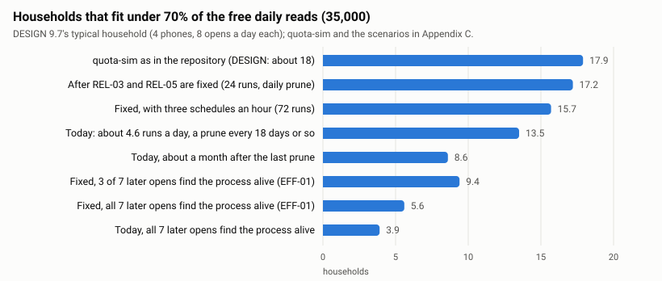

# 09 Efficiency: quota, battery, size, network and CI

Reviewed `0334b6a` on 2026-11-07 (the branch `review/2026-11` at `75228ee`, which adds only review reports).
Platforms: Android first; the web app; the reminder job, the nightly export and the workflows.

**Method.**

- **Counting reads and writes.** A scratch proxy (Appendix A) sat between the apps and the Firestore emulator: the
  emulator ran on 8181 and the proxy on 8080, where both apps look for it. It decodes both protocols (Android's gRPC,
  the web's WebChannel) and logs every listener the app starts, resumes or stops, every document the server delivers
  to each listener, and every write. A report script (Appendix B) turns a stretch of that log into billed reads. The
  emulator doesn't bill, and it re-sends a listener's whole result on every change and every resume, so the counts
  apply Firebase's published rules instead: one read per document per listener, at least one per query, and a
  listener that comes back after more than 30 minutes is billed like a new query (DESIGN 9.7 quotes the same rule).
  For a change, I count which listeners it reached, not what the emulator re-sent.
- **A typical household**, as DESIGN 9.7 and quota-sim define it: 30 products, 60 purchases and 30 tombstones, 2 lists
  with 25 items, 15 recipes, 42 meals, 40 activity events, 4 members (made-up accounts, Appendix D).
- **Android:** the dev debug build on Pixel_8 (Android 17, headless, section 08's setup), driven through `adb`: first
  sign-in, every tab, an own write, changes from another member (a Node client), an hour in the background with
  `dumpsys batterystats`, the return, a cold start, a process started in the background, and a write audit.
- **Web:** the emulator build (`npm run build`) served by `vite preview`, in Playwright's WebKit with the iPhone 15
  profile: first sign-in, every tab, two reloads (cold starts of the Home Screen app).
- **quota-sim:** the repository's simulation as it is, then a scratch copy with scenarios (Appendix C): the job's real
  run count, the prune's real cadence, a web member, the cursor margin, and phones that keep the app process between
  opens.
- **Size:** `apkanalyzer` on `assembleDevBenchmark`; the Vite build and its source map for the web.
- **CI:** `gh run list` and `gh run view` on the last 60 CI runs and every scheduled run since 21 October, read only.

No real Firebase project was touched, no workflow was run, and nothing in the source tree changed. Every script lived
in the scratchpad; the ones a fix needs are in the appendices.

## Summary

Much is frugal already: a phone's first sync reads 190 documents, a cold start later in the day about 37, nothing is
read in the background (Android cut the app's sockets 5 s after it left the screen and froze it for the whole idle
hour: no wake locks, alarms or jobs), the APK is 5 MB and a CI run takes four minutes. The quota is where the numbers
move. **Reads run out first, and DESIGN's "about 18 households" holds only on paper:**

- **Listeners that never let go** (the restock engine's, and Pantry's and Groceries' after a first visit) stay
  registered in the background and are resumed on the way back. After half an hour away Firebase bills each like a new
  query, and the restock engine's is the morning's full read of the pantry: one return after an hour cost about 190
  reads where DESIGN expects about 50. If phones keep the app process between opens, as they often do, a household
  costs 3,700 to 6,300 reads a day instead of 2,000, and **5 to 9 households fit** (EFF-01, P1; the emulator can't
  bill, so phone check 2 settles it).
- **Today's job** (about 4.6 runs a day and a prune every 18 days or so: REL-03, REL-05) leaves tombstones that every
  phone re-reads each day: **about 13 households fit today**, 8 a month after a prune, and the catch-up prune can
  exceed the daily delete limit. quota-sim also leaves out writes, reads and deletes it causes itself (EFF-02).
- Smaller: each screen opens its own pantry listeners, so a change is read up to three times by one phone (EFF-03); the
  job reads every user on every run (EFF-04); a background start for the digest reads the pantry (EFF-05); the web
  downloads its whole 359 KB bundle again on every release (EFF-06); about 400 KB of the APK can go (EFF-07); CI runs
  every job on every change (EFF-08); every open phone writes the same restock item (EFF-09).

9 findings: 1 P1, 1 P2, 7 P3. After REL-03 and REL-05 are fixed, about 17 households fit; fixing EFF-01 keeps it
there. Nothing went to the private notes.

## Metrics

### The numbers section 09 asks for

"Today" means the job as GitHub runs it now (about 4.6 runs a day, a prune about every 18 days: REL-03, REL-05);
"after the fix" means 24 runs and a prune every day, which is what quota-sim and DESIGN assume. Typical household of
DESIGN 9.7 (4 phones, 8 opens each a day, 40 actions a day).

| Metric | Value | How measured | Target or budget |
| --- | --- | --- | --- |
| Reads per household per day, Android only | **today 2,586; after the fix 2,034.** If phones keep the app process between opens: +1,700 (3 of 7 later opens) to +4,220 (all 7) (EFF-01) | quota-sim (repo: 1,952) and the scratch scenarios (Appendix C) | DESIGN 9.7: about 1,950 |
| Reads per household per day, mixed with the web (3 Android, 1 iPhone) | **2,026** after the fix (one web phone costs what an Android one does, less the update gate's document) | Scenario `WEB=1`; the web session measured the same listeners as Android | DESIGN 18.3: "about the same" |
| Writes per household per day | **94** in the model (40 actions, 10 month counts, the 40 activity events the sim writes but didn't count, 4 digest stamps). Measured per action: 1 to 4 writes, about a third of them activity events (table below) | Scenario; write audit | 20,000 a day for the project |
| Deletes per household per day | **57** with a daily prune (40 activity events, 15 tombstones, 2 meals); **0 most days today, then the backlog in one run** (prod: 74 tombstones on 7 Nov after 17 days) | Scenario; the 07:00 UTC run's public summary line | 20,000 a day |
| Households under 70% of the quota | **Today about 13** (8 after a month without a prune); **after the fix 17**; 15 with three schedules an hour; **5 to 9** if phones keep the process between opens (EFF-01). Reads run out first; writes would allow about 150 households, deletes about 245 | 35,000 / reads per household | DESIGN 9.8: about 18 |
| Reads per cold start | **First open of the day: 191** on Android, **190** on the web (products 30, stock 60 + 30 tombstones, items 21-24, recipes 15, this week's 12 meals, 10 events, members, lists and the rest). **Later cold start: 37** (24 when the last open was under 30 minutes ago). Web reload: 17 after more than 30 minutes, about 2 within. **Return after an hour with the process alive: about 190**, of which about 140 from listeners that never stopped (EFF-01). Process started in the background: 17, up to about 125 when the day's full read is due (EFF-05) | Counting proxy, scripted sessions | DESIGN 13.1: first household sync under 2 s |
| The job's reads per day | **Today 430 per household** (users query 18, digests 16, housekeeping 58, nightly export 338 with the tombstone backlog); **after the fix 390** (users query 96, export 210); 582 with three schedules an hour | Scenario job parts, from `job.ts` and `backup.ts` | DESIGN 9.7: "a few hundred" |
| APK size | **4.97 MB** file, **4.29 MB** download (4,973,656 / 4,290,600 bytes), same as section 00; about 400 KB could go (EFF-07) | `apkanalyzer` on `assembleDevBenchmark` | — |
| Web first load (gzip) | **About 430 KB** for the welcome screen (JS 359, CSS 8.6, two font files 54.5, the rest 8); about 520 KB once the service worker has precached everything | `vite build`, each file gzipped at level 9 | Lighthouse 92 (section 00) |
| Web precache | **21 entries, 1,488.5 KiB raw, 518 KB gzip, 457 KB brotli**; 165 KB of it rarely or never used (EFF-06) | vite-plugin-pwa manifest in `sw.js` | — |
| Background wake-ups per hour | **0**: cached and frozen the whole hour, no wake locks, alarms, jobs or syncs; 274 ms of CPU and one 40-byte packet (the socket teardown). Plus one process start a day for the digest (EFF-05) | `dumpsys batterystats` after 65 minutes in the background (battery unplugged), `dumpsys alarm`, `dumpsys jobscheduler` | — |
| CI minutes per pull request | **7.4 job-minutes per pull request run** (median of 50), 7.3 per push to `main`, so **about 15 per merged pull request**, 4.3 minutes of waiting; free (the repository is public) | `gh run view --json jobs` on the last 60 CI runs | DESIGN 13.2 still budgets 2,000 private minutes (CODE-02) |

### Every listener and one-off read

Android first. "Server query" is what the phone asks Firestore for and pays for; each also has a free cache listener
(DESIGN 9.8). "5 s" means `WhileSubscribed(5_000)`: the listener stops 5 seconds after its screen is left. "Never"
means while the process lives, also with the app in the background.

| Server query | Started by | Stops | Notes |
| --- | --- | --- | --- |
| `users/{uid}`, own `members/{uid}` | `SessionManager` (application scope) | sign-out | Settings and notification settings share the same query |
| `config/app` | `RootViewModel` (`Eagerly`) | activity destroyed | Android only (the web has no update gate) |
| `groceryLists` (names) | restock engine; Home, Groceries, Plan, recipe sheets | **never** (engine) | |
| `products`, `stock`: the day's full read, or changes since a cursor | restock engine; Pantry's ViewModel (`init`); Groceries' ViewModel (`init`); Home, Plan (5 s); recipe sheets while open | **never** for the first three (EFF-01) | Each call computes its own cursor, so two or three listeners per collection (EFF-03) |
| default list's `items` (changes-only) | Groceries' ViewModel (`init`); Home (5 s); Plan's and recipes' list sheets while open | **never** after Groceries is opened | |
| `members` | Groceries' ViewModel (`init`); Home, Plan, Settings, household settings (5 s) | **never** after Groceries | |
| `joinRequests` | Shell (owner's badge, 5 s), household settings | 5 s | owner only |
| `activity`, newest 10 (changes-only) | Home (5 s) | 5 s | |
| `stats`, this month / six months | Home (5 s) / Insights (5 s) | 5 s | |
| `meals`, this week (changes-only, per window) | Home's Today card, Plan (5 s) | 5 s | |
| `recipes` (changes-only) | `RecipeStore` (application scope, 5 s): Home's Use it up, Recipes | 5 s | |
| `activity` where `productId` | a product's history | 5 s | |
| one-off: profile and device document | `DeviceSync` at every process start | — | the profile read is served by the profile listener; the device read costs 1 |
| one-off: whole household | Export, Clear household data, Delete list | — | on demand; tombstones are read too |

The web follows Android with two differences: screens subscribe while mounted (`refCount`), so each tab switch
re-attaches its queries (a few reads; free within 30 minutes when the query is unchanged); and it has no
`config/app`. Its restock engine and session start at page load and never stop (`main.tsx:18-20`). There is no
`visibilitychange` handling: a hidden tab keeps listening in a desktop browser; an iPhone suspends the Home Screen
app soon after it leaves the screen.

### Reads per step, measured (typical household)

Billed reads per Firebase's rules, from the counting proxy. "Resumed" listeners are free when the phone was away
under 30 minutes and billed in full after that; both are shown where it matters.

| Step | Android | Web (iPhone profile) |
| --- | --- | --- |
| First sign-in on a new phone (the day's full read) | **191**: 15 listeners; products 30 + a second, changes-only products listener 1; stock 90 (60 + 30 tombstones) + a second stock listener 1; items 21; recipes 15; meals 12; activity 10; members 4; lists 2; profile, membership, `config/app`, stats 1 each; join requests 1 | **190**: 11 listeners, the same reads without `config/app` and join requests (a member) and without the second pair |
| Idle on Home for 20 s | 0 | — |
| Open Pantry / Groceries / Recipes / Plan the first time | 0 / 1 / 1 / 1 | 2 / 2 (+ 6 resumed) / 1 / 1 (+ 4 resumed) |
| Own +1 on a purchase | 1 write; the change came back on **2 stock listeners** | — |
| Back to Home after that write | **3** new (stock 2, activity 1) + 3 resumed | — |
| Back to Home with no change since | 0 new + 3 resumed | — |
| Another member changes one purchase (with its event), phone on Home | the change reached **3 stock listeners** and the activity listener: **4 reads** instead of 2 | — |
| Another member adds a grocery item | 1 + a 1-read lookup of a document the phone thought was missing ("limbo") | — |
| Reload of the Home Screen app (cold start) | — | **17** if away more than 30 minutes (all 11 listeners resumed from IndexedDB), about 2 within |
| Return after an hour in the background, process alive | **about 190** (17 listeners resumed or restarted; about 140 of it from the restock engine's, Pantry's and Groceries' listeners, EFF-01) | Not measured (WebKit doesn't suspend pages) |
| Cold start later in the day (process killed) | **37**: 13 listeners, one per collection; 24 if the last open was under 30 minutes ago | see the reload row |
| Process started in the background (as the digest does) | **17**: profile, membership, lists, products, stock; about 125 when the day's full read is due (EFF-05) | — |

### Quota scenarios (quota-sim, typical household, per day)

| Scenario | Reads | of which app listeners / rule lookups / job | Writes | Deletes | Households under 70% |
| --- | --- | --- | --- | --- | --- |
| quota-sim as in the repository | 1,952 | 1,300 / 304 / 348 | 54 | not counted | 17.9 |
| "After the fix": 24 runs, daily prune, with EFF-02's gaps counted | 2,034 | 1,300 / 344 / 390 | 94 | 57 | 17.2 |
| Today: 4.6 runs, prune every 18 days (160 tombstones on an average day) | 2,586 | 1,812 / 344 / 430 | 94 | 57 (in bursts) | 13.5 |
| Today, a month after the last prune (460 tombstones) | 4,086 | 3,012 / 344 / 730 | 94 | 57 (in bursts) | 8.6 |
| Fixed, 72 runs (three schedules an hour) | 2,226 | 1,300 / 344 / 582 | 94 | 57 | 15.7 |
| Fixed, one web phone of four | 2,026 | 1,292 / 344 / 390 | 94 | 57 | 17.3 |
| Fixed, four web phones | 2,002 | 1,268 / 344 / 390 | 94 | 57 | 17.5 |
| Fixed, one extra document per changes-only query from the 5-minute margin (EFF-03) | 2,202 | + 168 margin | 94 | 57 | 15.9 |
| Fixed, 3 of 7 later opens find the process alive (EFF-01) | 3,736 | + 1,630 resumed | 94 | 57 | 9.4 |
| Fixed, all 7 later opens find it alive (EFF-01) | 6,256 | + 4,054 resumed | 94 | 57 | 5.6 |
| Today, all 7 later opens alive | 9,058 | + 6,304 resumed | 94 | 57 | 3.9 |

Reads run out first in every scenario: writes would allow about 150 households (14,000 / 94) and deletes about 245
(14,000 / 57), except on a catch-up prune day (EFF-02). Firestore's other free limit, 10 GiB of outbound data a month,
is far off: a document read cost about 0.4 KB over gRPC and about 1 KB over the web's uncompressed WebChannel here, so
a household's 2,000 to 6,000 reads are 1 to 6 MB a day.

**Does quota-sim model the web and the planner?** The meal planner yes (this week's meals, their changes, the digest's
meals query, the export and the prune). Web members no: every phone is Android. Measured, a web phone reads the same
listeners minus `config/app`, so it costs about the same (DESIGN 18.3 is right).

### Writes per action (Android, write audit)

| Action | Writes | Which |
| --- | --- | --- |
| Add item (new product) | 3 | product, purchase, activity event |
| Use 1 | 1 | purchase (increment) |
| Used up | 2 | purchase tombstone, month count |
| Throw away | 3 | purchase tombstone, activity event, month count |
| Add to the grocery list | 2 | item, activity event |
| Check off | 2 | item, activity event (store order: none, it was already learned) |
| Add to pantry | 4 per item | product, purchase, activity event, grocery-item tombstone |
| Restock (a staple below Keep at least) | 2 per open phone | grocery item, product (EFF-09) |

Seven of the audit's 24 writes were activity events. A day of DESIGN's 40 actions is therefore about 60 to 100 writes,
close to the model's 94.

### Growth over a year

Sizes from Firestore's storage rules applied to real-shaped documents: a product 473 B, a purchase 388 B (406 as a
tombstone), a grocery item 395 B, an imported recipe with 12 ingredients and 8 steps 3.2 KB, a meal 394 B, an activity
event 244 B, a month of Insights 229 B.

| | With a daily prune | Without (today, REL-05) |
| --- | --- | --- |
| Activity events (the model's 40 a day) | 30 days kept: about 1,200 (290 KB), the largest part of a household | +40 a day: 14,600 a year (3.5 MB); not read by phones (only the newest 10), read once by the next prune |
| Tombstones | about 30 (2 days) | +15 a day: 5,475 a year (2.2 MB); **read by every phone's daily full read and the export** (EFF-02) |
| Meals | 28 days past plus the future: about 70 | +2 a day: 730 a year; read by the export every night |
| Insights months | +12 a year, never pruned (2.7 KB); the export reads all of them, Insights 6 | same |
| Per household | about 410 KB of documents (plus indexes, roughly as much again) | +5.8 MB of documents a year |
| Free storage (1 GiB) | about 1,000 households | still hundreds; storage is not the limit, reads are |

### Network

| Item | Value | Notes |
| --- | --- | --- |
| Reading the whole household | about 73 KB over gRPC for about 200 documents (Android, a full resync); 280 KB over the emulator's uncompressed WebChannel for the web's first sign-in, tab tour and two reloads | Proxy byte counts; production compresses the web's JSON |
| Recipe import | one page, 15 s timeout, 3 MB cap, redirects followed (`OkHttpRecipeImportService.kt:22,82-83`) | Matches DESIGN 11.2; the built-in browser fallback loads whole pages, by the person's choice |
| Recipe photos | the site's original image URL, fetched once per phone and kept in Coil's disk cache; decoded at the card's size (section 08). On the web the browser's cache | No size cap on the download; a 1,200 px photo is typically 100 to 400 KB. Fine for 15 recipes |
| Firebase telemetry | Firebase Sessions tracks app sessions (it logged "App backgrounded" on the emulator build too); its uploads go through the datatransport job, which didn't run during the idle hour | — |

### APK (dev benchmark build: release code, R8, debug-signed)

| Part | Compressed | Raw |
| --- | --- | --- |
| `classes.dex` | 3.63 MB | 7.92 MB (6.0 MB of defined code: Compose 29%, the app 12%, Firebase 8%, Play services 7%, gRPC 5%, Coil 4%, `re2j` 2%, kotlinx 4%, OkHttp and Okio 4%, jsoup 2%, DataStore 2%) |
| `resources.arsc` | 0.64 MB | stored uncompressed (Android 11+) |
| `google/**/*.proto` (90 files) | 219 KB | 670 KB |
| `res/` (two fonts 170 KB, licences JSON 15 KB) | 190 KB | 455 KB |
| Native libraries (4 ABIs × 2) | 67 KB | 67 KB |
| OkHttp's public suffix list | 42 KB | 133 KB |
| Baseline profile | 12 KB | 12 KB |
| Total | **4.97 MB** file, **4.29 MB** download | — |

Background components in the merged manifest: the FCM receiver and service, Firebase's datatransport job and alarm
receiver, the profile installer's receiver. No WorkManager, no boot receiver, no foreground service; permissions
`INTERNET`, `ACCESS_NETWORK_STATE`, `WAKE_LOCK`, `POST_NOTIFICATIONS` and C2DM.

### Web bundle (`npm run build`, emulator config)

| Part | Raw | gzip -9 | brotli |
| --- | --- | --- | --- |
| Main chunk `index-*.js` | 1,216.8 KB | 359.3 KB | 302.8 KB |
| `firebase/messaging` chunk (loaded only with push) | 24.9 KB | 7.8 KB | 7.0 KB |
| CSS | 47.9 KB | 8.6 KB | 7.6 KB |
| Fonts: 9 subsets (only Manrope Latin and Fredoka Latin are drawn) | 118.1 KB | woff2: 118.1 KB (Latin pair 54.6 KB) | — |
| `licenses.json` | 102.5 KB | 11.5 KB | 8.6 KB |
| Icons, manifest, `index.html`, service worker | 32.8 KB | 19.3 KB | — |
| **Welcome screen, first visit** | — | **about 430 KB** | about 375 KB |
| **Precache** (21 entries) | **1,488.5 KiB** | **518 KB** | **457 KB** |
| Main chunk by source | Firestore 354 KB, React DOM 208 KB, `re2js` 149 KB, Auth 70 KB, the app's domain 54 KB, WebChannel 49 KB, the app's data 32 KB, screens about 170 KB, strings 28 KB, rxjs 26 KB (the app's own code: about 300 KB, a quarter) | | |

### CI and the dev loop

| Item | Value | How measured |
| --- | --- | --- |
| CI run, waiting time | median **260 s**, p90 423 s | 50 successful runs, 29 Oct to 2 Nov |
| Jobs (median / p90) | android 65 / 340 s, web 236 / 349 s, firestore-rules 52 / 62 s, reminder-job 47 / 60 s | `gh run view --json jobs` |
| Job-minutes per run | **7.2** median (8 when each job is rounded up to a minute) | Sum of the four jobs |
| Per pull request | 7.4 job-minutes per pull request run (most pull requests have one run), 7.3 for the push to `main`: **about 15 per merged pull request**; plus `secret-scan` (11 s) on both | 26 pull request branches |
| Slowest steps | web browser tests 2.1 min; WebKit and its system packages 37 s per run; Android's Gradle step 45 s median | Step timings |
| Reminder workflow | 81 runs since 21 October (4.6 a day); two jobs per run (prod, dev), 15 s each, of which the job itself 4 s | `gh run list`, `gh run view` |
| Nightly export | 19 runs, 19 s median; starts hours late (section 05) | same |
| Local finishing checks | 9.5 minutes one after another (section 00); about 5.5 in two parallel lanes | Section 00's timings |
| Cost | $0: the repository is public, so Actions minutes are free; DESIGN 10.4 and 13.2 still budget 2,000 private minutes | `gh repo view` |

## Findings

### EFF-01 · P1 · Confirmed (listeners) · Likely (billing) · Android + web — Listeners that never let go are billed in full again on every return after half an hour, which can cut the households that fit from 17 to 5–9

- **Where:** `feature/grocery/domain/RestockRunner.kt:53-71` (started from `SpoilNotApp.kt:43` in the application
  scope; it keeps `pantry.observe` and `observeLists` for as long as the process lives);
  `feature/pantry/ui/PantryViewModel.kt:101-107,128-135` (`data` collected from `init` for `deleteEmptyBatches`);
  `feature/grocery/ui/GroceriesViewModel.kt:110-136,145-148,247-250` (`state` collected from `init` for "someone
  added", which keeps the items, lists, members and pantry listeners); `core/firebase/DeltaSync.kt:120-135` (the server
  query is chosen once, when the flow starts: the day's full read or a cursor). Web: `web/src/main.tsx:18` and
  `web/src/domain/grocery/restock.ts:97-122` (the restock engine from page load).
- **What happens:** DESIGN 9.8's saving assumes each return to the app starts fresh listeners that ask only for what
  changed. Three owners never stop theirs: the restock engine (from the moment the process starts), and Pantry's and
  Groceries' ViewModels (from their first visit, section 08's hand-off). In the background that costs nothing: Android
  cut the app's sockets 5 s after it left the screen ("Destroyed live tcp sockets for uids={10331}") and froze it two
  minutes later, so nothing was read for the whole hour. But the listeners stay registered, and on the way back the SDK
  resumes every one of them. Firebase bills a listener that was away more than 30 minutes like a brand-new query, and
  the restock engine's listener is usually the day's **full read** of products and stock (it starts with the first
  open of the day). So every later return that finds the process alive re-reads the whole pantry, tombstones included,
  on top of the changes-only reads DESIGN counts. The web does the same when an iPhone resumes a suspended Home Screen
  app instead of reloading it.
- **Evidence:** Pixel_8, the same process (pid 8607) before and after an hour in the background, then brought back;
  the proxy saw these listeners resumed at once:

  | Listener | Owner | Documents (billed after 30 min away) |
  | --- | --- | --- |
  | `products` and `stock`, the full read from the first open (30 + 60 purchases + 30 tombstones) | restock engine, Pantry's and Groceries' ViewModels (they share identical queries) | 120 |
  | `products` and `stock` since a cursor from the first open | the same owners (one of them got a cursor) | 1 + 5 |
  | default list `items` since a cursor from the first visit | Groceries' ViewModel | 15 |
  | Profile, membership, `config/app`, lists, members, join requests | session, shell | 10 |
  | Home's own queries (stats, recipes, meals, new stock, activity and items cursors) | Home, re-attached | 39 |
  | **Total for one return** | | **about 190, of which about 140 from the listeners that never stopped** |

  DESIGN's model for the same return is the last two rows, about 50. Billing follows Firebase's 30-minute rule
  ("Understand Cloud Firestore billing"; DESIGN 9.7 quotes it): the emulator can't bill, which is what keeps the
  billing part *Likely*. In quota-sim (Appendix C), after REL-03's fix:

  | Later opens that find the process alive (of 7 a phone a day) | Reads per household per day | Households under 70% |
  | --- | --- | --- |
  | 0 (what quota-sim and DESIGN assume) | 2,034 | 17.2 |
  | 3 | 3,736 | 9.4 |
  | 7 | 6,256 | 5.6 |
  | 7, with today's job (tombstones unpruned, EFF-02) | 9,058 | 3.9 |

- **Who it affects:** every household, through the shared daily quota. How often a phone keeps the process between
  opens varies with its memory, its maker and how the person uses it; the emulator kept it the whole hour. Phone
  check 2 measures one return on the owner's phone.
- **Suggested fix:** let nothing hold a household listener outside a visible screen. (1) One shared pantry flow per
  household (`shareIn(appScope, WhileSubscribed(5_000))`, as PERF-02 proposes) for every screen and the restock
  engine. (2) The engine reads the cache only (`ListenSource.CACHE`, free) and reacts to what the screens' server
  listeners and this phone's own writes put there. (3) `deleteEmptyBatches` and "someone added" move inside the
  screens' own `WhileSubscribed` lifetime. (4) A listener that would resume after more than 30 minutes is restarted
  with a fresh cursor instead (`ProcessLifecycleOwner` `ON_START` after a long `ON_STOP`; `visibilitychange` on the
  web). Effort M. Also needs: the web port, DESIGN 9.1 (lifetimes) and 9.6 (where the engine listens), 9.8, a quota-sim
  scenario, an instrumented test that counts server listeners after leaving and coming back.

### EFF-02 · P2 · Confirmed · Backend + docs — "About 18 households" assumes 24 runs and a daily prune; today it is about 13, and falls as tombstones pile up

- **Where:** DESIGN 9.7 and 9.8, RUNBOOK "Check quota usage"; `firebase/tools/quota-sim.mjs:23,28-29,170-185`;
  `backend/reminder/src/job.ts:216-256` (`prune`); `backend/reminder/src/backup.ts:62-80` (the export reads tombstones and
  drops them afterwards).
- **What happens:** the capacity everyone quotes comes from quota-sim, which assumes the job runs 24 times a day and
  prunes daily. GitHub runs it about 4.6 times a day and pruned once in 18 days (REL-03, REL-05, cited, not re-reported).
  Fewer runs read less, but no prune costs more: tombstones stay, and every phone's daily full read of products, stock
  and the grocery list reads them all again, as does the nightly export. With 15 deletions a day (quota-sim's own
  figure) and a prune about every 18 days, an average day has about 160 tombstones instead of 30. A month without a
  prune makes it about 460. When the prune finally runs, it deletes the whole backlog in one run: about 57 deletes per
  household per day of backlog (activity, tombstones, past meals), so 18 households after 20 days without a prune need
  20,520 deletes, over the 20,000 a day, so the `BulkWriter` would fail part way (counted in `pruneFailures` on `main`).
  The prod run on 7 November, the first in the 07:00 hour since 21 October, deleted 74 tombstones (the beta is small).
- **Gaps in quota-sim itself**, which keep its number optimistic even after the fix: it writes an activity event for
  each of the 40 daily actions but doesn't count them as writes (50 → 90 writes per household) or their rule lookups
  (+40 reads); its housekeeping doesn't count the documents it reads before deleting them (+42); it has no deletes
  (BASE-06); all phones are Android (a web phone costs about the same: 2,026 against 2,034); and it can't see the
  listeners that EFF-01 and EFF-03 describe, because it lists the queries by hand.
- **Evidence:** scenarios in Appendix C, typical household:

  | Scenario | Reads per household per day | Households under 70% |
  | --- | --- | --- |
  | quota-sim as in the repository | 1,952 | 17.9 |
  | The same assumptions, with the gaps above counted ("after the fix") | 2,034 | 17.2 |
  | Today: 4.6 runs a day, a prune every 18 days | 2,586 | 13.5 |
  | Today, about a month after the last prune | 4,086 | 8.6 |

  
- **Who it affects:** every household; the beta is far from the limit today, so this is about the numbers the owner
  plans with.
- **Suggested fix:** REL-05's fix (prune in the first run of each UTC day) removes the backlog and the burst. Then
  update quota-sim: count the events and the housekeeping reads, add deletes (BASE-06), a `WEB` and a `RUNS` knob,
  and re-state DESIGN 9.8 and the RUNBOOK with the new number (about 17). Effort S. Also needs: DESIGN 9.7, 9.8,
  RUNBOOK.

### EFF-03 · P3 · Confirmed · Android + web — Each screen starts its own pantry listeners, so one change is read up to three times by the same phone

- **Where:** `feature/pantry/data/FirestorePantryRepository.kt:36-46` (each `observe` call makes its own pair of
  `liveDocuments`, each computing its own cursor), called by the restock engine, Home, Pantry, Groceries, Plan and the
  recipe sheets; the same for the default list's items. Web: `web/src/data/pantry.ts:90-97`, called by
  `HomeScreen.tsx:54`, `PantryScreen.tsx:58`, `GroceriesScreen.tsx:73`, `PlanScreen.tsx:525,547,596`,
  `RecipeDetailScreen.tsx:376,422` and the restock engine.
- **What happens:** Firestore shares a listener only between identical queries. The cursor is "newest cached change
  minus 5 minutes" at the moment a screen attaches, so a screen opened after any change gets a query of its own. Each
  change to a purchase is then billed once per listener on every phone that has the app open, this phone's own writes
  included. Each return to Home or Plan after 5 s away also starts new queries: at least one read each, plus every
  document changed in the 5 minutes before the newest one (after Add to pantry of 15 items, 30 documents per return).
  Sections 04 and 08 found the structure; this is its cost.
- **Evidence:** on Pixel_8 after visiting the tabs, `stock` had three server listeners (the morning's full read, two
  cursors) and `products` and the list's items two each. Another member's change to one purchase (with its event) cost
  this phone 4 reads instead of 2; its own +1 came back on 2 listeners; the staple drop of EFF-09 reached 3 `stock` and
  2 `items` listeners on Android and 1 each on the web. A return to Home after an own write cost 3 new reads. At the
  first sign-in, Android already opened a second `products` and `stock` listener next to the full read. In quota-sim,
  one extra document per changes-only query costs 168 reads per household a day (17.2 → 15.9 households).
- **Who it affects:** households whose phones have the app open while someone changes things.
- **Suggested fix:** EFF-01's shared pantry flow gives one listener pair per collection and phone; keep the cursor per
  collection while that listener lives (SYNC-01's fix keeps it per collection anyway). Effort M, with EFF-01.

### EFF-04 · P3 · Confirmed · Backend — Every reminder run reads every user with reminders on, so more schedules multiply it

- **Where:** `backend/reminder/src/job.ts:115` (`users where notificationPrefs.enabled == true`, every run);
  `.github/workflows/reminders.yml:7` (hourly).
- **What happens:** each run reads every user who has reminders on, to find the few who are due now. For most of the
  day everyone has already had today's digest, so nearly all of these reads find nothing to do. At 24 runs a day that's
  24 reads per user (96 per household, 5% of its reads). REL-03's first suggested fix, three schedules an hour
  (`7,27,47 * * * *`), makes it 72 per user (288 per household) and costs about one and a half households of capacity
  (17.2 → 15.7). Today, with about 4.6 runs, it's 18 per household.
- **Evidence:** scenarios `fixed` and `fixed-72runs` (Appendix C); the query in `job.ts`.
- **Who it affects:** the shared quota, in proportion to the number of users with reminders on.
- **Suggested fix:** keep a `nextDigestAt` timestamp on each user: the job sets it after each digest (tomorrow at the
  chosen hour in the user's zone) and for any user without one; the app clears it when the hour, the zone or reminders
  change. The job then queries `nextDigestAt <= now` and reads only the users who are due (at least one read a run), so
  extra schedules cost almost nothing. Effort M. Also needs: the field in the rules for the user's own document, the
  web port, DESIGN 10.3, a job test across a DST change.

### EFF-05 · P3 · Confirmed · Android — A process started in the background, as the daily digest does, starts the listeners and reads

- **Where:** `SpoilNotApp.kt:39-46` (`restockRunner.start()` and `deviceSync.start()` in `Application.onCreate`, which
  runs for any process start, including the FCM receiver's).
- **What happens:** when a digest arrives and the app isn't running, Android starts its process to show the
  notification, with network allowed for a few seconds (a high-priority message). `onCreate` then starts the session,
  the device sync and the restock engine, which open the profile, membership, lists, products and stock listeners and
  read them, though nobody is looking. If the last full read is more than 20 hours old, as it often is in the morning,
  that's the whole pantry (about 125 documents here). Those listeners then stay registered, so the next open resumes
  them (EFF-01).
- **Evidence:** Pixel_8: the app in the background, killed (`am kill`), the network allowed as FCM does it (`cmd
  deviceidle tempwhitelist`), and the process started by a broadcast to its profile-installer receiver (the emulator
  build gets no FCM token). With the launcher still on top, the proxy saw 5 listeners attached and 17 documents read
  within a second (cursors from that afternoon). Commands in Appendix D.
- **Who it affects:** every phone with reminders on, once a day; also token refreshes and app updates.
- **Suggested fix:** start the household listeners (restock engine, session watchers that need the server) when an
  activity starts (`ProcessLifecycleOwner` `ON_START`), not in `Application.onCreate`; the notification service
  needs none of them. The device sync can stay (one read). Effort S. Also needs: DESIGN 9.6 ("runs on every phone
  while in a household" becomes "while the app is open"), a test that a background start attaches no listener.

### EFF-06 · P3 · Confirmed · Web — One 1.2 MB chunk: every release downloads all of it again, and the precache holds 165 KB that is rarely or never used

- **Where:** `web/vite.config.ts:44` (precache globs) and `:48-54` (no `manualChunks`; BASE-05's size warning); no lazy
  screens (`firebase/messaging` is the only dynamic import, `data/notifications.ts:120`).
- **What happens:**
  - The app is one 1,217 KB chunk, 359 KB gzipped. By the source map: Firestore 29%, React DOM 17%, `re2js` 12% (a
    regular-expression engine that Firestore 4.19, in firebase 13.1.0, now depends on), Auth 6%, WebChannel 4%, rxjs
    2%, and the app's own code about a quarter. Every web release changes the chunk's name, so every iPhone downloads
    all 359 KB again when only the app's part (roughly 90 KB gzipped) changed.
  - The welcome screen loads all of it, signed-in screens included (Lighthouse's 274 KiB of unused JavaScript,
    BASE-05). An installed app reads it from the service worker's cache, so this matters for the first visit and after
    each release.
  - The service worker precaches `licenses.json` (102 KB raw, 11.5 KB gzipped, read only by About > Licenses) and the
    Greek, Cyrillic, Vietnamese and Hebrew font subsets (63 KB) that an English interface never draws. A browser would
    fetch a subset only when a character needs it; the precache fetches all of them at install.
  - Icons are fine: 70 hand-picked Material icons, 24 KB raw.
- **Evidence:** `npm run build` (emulator config) and a source-map attribution script (Metrics, Web bundle).
- **Who it affects:** iPhone users on mobile data at install and after every release.
- **Suggested fix:** split third-party code from the app's (`build.rollupOptions.output.manualChunks`: Firebase,
  React, the rest), so a release downloads roughly 90 KB instead of 359; optionally lazy-load the signed-in screens; leave
  `licenses.json` and the non-Latin font subsets out of the precache (`globIgnores`) so they load on demand. Effort S
  to M. Also needs: a DECISIONS entry (2026-10-30 chose one chunk), BASE-05's limit.

### EFF-07 · P3 · Confirmed · Android — About 400 KB of the APK isn't needed: proto sources, whole fonts, emulator libraries

- **Where:** `app/build.gradle.kts` (no `packaging.resources.excludes`, no `abiFilters`); `app/src/main/res/font/`.
- **What happens:** the 4.97 MB APK (4.29 MB download) is lean for a Compose and Firebase app, R8 and resource
  shrinking work, and the baseline profile is in (10 KB). What could still go:

  | What | Size in the APK (compressed) | Why it's there |
  | --- | --- | --- |
  | 90 `google/**/*.proto` files (Google API, RPC, type and Firestore protos, even Google Chat's card schema) | 219 KB (670 KB raw) | Shipped as resources by the protobuf and common-protos libraries; nothing reads them at run time |
  | Manrope and Fredoka as whole variable TTFs | 170 KB (324 KB raw) | The web ships Latin subsets of 25 and 30 KB for the same look |
  | x86 and x86_64 copies of two small native libraries | 34 KB | Only emulators and Chromebooks use them |
  | `kotlin/*.kotlin_builtins`, `DebugProbesKt.bin`, Maven metadata | about 20 KB | Build leftovers |
  | `androidx.fragment` and `concurrent-futures` (section 11's hand-off) | 58 KB and 4 KB of DEX | Declared only to align test dependencies (DECISIONS 2026-10-18) |

  `kotlinx-serialization-core` next to `-json` costs nothing (one copy). Firestore's own `re2j` (141 KB of DEX) and the
  OkHttp public suffix list (42 KB) stay.
- **Evidence:** `apkanalyzer apk file-size`, `download-size`, `files list`, `dex packages --defined-only`, `unzip -lv`
  (Metrics, APK).
- **Who it affects:** every install and update download (about 8% of it).
- **Suggested fix:** `packaging { resources { excludes += listOf("google/**/*.proto", "kotlin/**",
  "DebugProbesKt.bin") } }`; subset the two fonts to Latin and Latin Extended (as the web did) or use the variable
  fonts' needed axes only; `ndk { abiFilters += listOf("arm64-v8a", "armeabi-v7a") }` for release builds only (the
  benchmark build runs on the emulator, so keep x86_64 there); and move the test-alignment libraries to the test
  configurations if DECISIONS 2026-10-18's reason allows. Effort S. Also needs: a phone check of the fonts.

### EFF-08 · P3 · Confirmed · CI and dev loop — Every CI job runs on every change, the web job installs WebKit each time, and the local checks run one after another

- **Where:** `.github/workflows/ci.yml:3-20` (one path filter for the whole workflow) and `:136-140` (`npx playwright
  install --with-deps webkit`); CLAUDE.md "Before finishing a task".
- **What happens:** CI is quick (4.3 minutes of waiting, about 15 job-minutes per merged pull request), and minutes are
  free since the repository went public. Still:
  - A change under any of `app/`, `web/`, `firebase/` or `backend/` runs all four jobs: an app-only change runs the
    rules tests (52 s) and the reminder job (47 s), a web-only change the Android job (65 s median, up to 9 minutes
    after a dependency update clears the cache). The web job is the one people wait for (236 s median, p90 349 s):
    2.1 minutes of browser tests and 37 s of WebKit and its system packages installed every run.
  - Locally, the finishing checks take 9.5 minutes one after another (section 00). Lint is the largest Android part
    (58 + 22 + 15 s of task time, the last two linting the unit and instrumented test sources), and `assembleDebug`
    also builds prod debug (`mergeExtDexProdDebug` 21 s). Gradle work and the Node checks could run side by side: the
    Android checks and Roborazzi (125 s) next to the web checks, then the instrumented and browser tests against the
    same emulators (190 and 198 s), for about 5.5 minutes in all.
  - The reminder workflow runs two jobs per run (prod and dev); the job itself takes 4 s inside a 15-second job.
- **Evidence:** `gh run view --json jobs` on 50 successful CI runs (Metrics, CI) and the web job's log of
  `41462798290`.
- **Who it affects:** the owner's wait per pull request and per local check; not money.
- **Suggested fix:** per-job path filters (a `changes` job with `dorny/paths-filter`, or `if:` on `github.event` paths)
  so rules and reminder jobs run only on `firebase/` and `backend/`, and Android only on Android and generated-web
  paths; run the web job in the Playwright container image (`mcr.microsoft.com/playwright`, pinned to the
  project's Playwright version), which already has WebKit and its system packages; a `scripts/check-all.sh` that runs the Gradle and Node lanes in parallel (section 00's Idea). Keep
  linting test sources (section 11 wants more checks there, not fewer). Effort S. Also needs: CLAUDE.md, DESIGN 13.2.

### EFF-09 · P3 · Confirmed · Android + web — Every open phone writes the same restock item, and check-offs double the writes of a shopping trip

- **Where:** `feature/grocery/domain/RestockRunner.kt:74-95` and `web/src/domain/grocery/restock.ts` (every phone
  evaluates and writes); `feature/grocery/domain/GroceryService.kt:162-183` (a check-off writes the item and an event).
- **What happens:**
  - When a staple drops below Keep at least, every phone with the app open runs the engine on the same snapshot and
    writes the same grocery item and the same `restockArmed = false`. DESIGN 9.6 calls it idempotent, which it is for
    the data, but each copy is a write, and each write is then read back by every listener on every open phone.
  - Each check-off writes the item and a "checked off" activity event, so a shopping trip of 20 items costs 40 writes
    (and puts 20 events in Recent activity, UX-16).
  - The questions the plan asked: store-order learning writes only when the learned order changes (`StoreOrder.learn`
    returns null otherwise; 0 writes in the audit); neither app writes the time zone at every start (it reads the
    profile and writes only when the zone changed; 0 writes over the web's first sign-in and two reloads, and on
    Android's starts); `deleteEmptyBatches` runs on every phone whose Pantry was opened, so two phones can tombstone the
    same empty purchase (by reading, rare).
- **Evidence:** Pixel_8 and the web app both open on Home; another member used a staple down to 1 of 2: the web wrote
  `items/low_p0` and `products/p0`, and Android wrote the same two 70 ms later (4 writes for one event). Write audit
  (Metrics): 2 writes per check-off.
- **Who it affects:** households with several phones open at once (shopping together), and the write quota only at a
  scale far beyond the read limit; the reads each write triggers matter more.
- **Suggested fix:** let the phone whose own write caused the drop (a snapshot with `hasPendingWrites`) act at once,
  and other phones only after a few seconds if the item still isn't there; stop logging check-offs or fold them per
  trip (UX-16's fix). Effort S. Also needs: web port, DESIGN 9.6, the restock unit tests (two concurrent evaluations).

## Ideas

- **A read counter on the hidden debug screen** (DESIGN 9.7 already suggests one): count documents per listener from
  the snapshots' `documentChanges` and show reads per session. It would have shown EFF-01 and EFF-03 in the beta, and
  it's the only per-phone number the owner can read without the emulator.
- **Keep the counting proxy** (Appendix A) as `firebase/tools/count-proxy.mjs` with a RUNBOOK paragraph: it measures
  any change's reads on the emulators, for both apps, in a few minutes.
- **Make quota-sim follow the app instead of describing it.** Today it lists the queries by hand, so it can't see a
  listener that the app keeps (EFF-01) or opens twice (EFF-03). An instrumented test could run the real repositories
  through the proxy for a scripted day and assert a budget (for example "under 2,100 reads for the typical household"),
  failing the build when a change costs more.
- **A Home Screen web app could reload instead of resuming** after a long absence (`visibilitychange` with a timestamp):
  a reload computes fresh cursors and costs 17 reads here, where resuming a day-old full read costs the whole pantry.
- **Tell the owner where the quota goes.** The Firebase console shows totals only; a line in the job's public summary
  with the number of households, users with reminders and tombstones would make growth visible run by run.

## For other sections

- **05 Reliability:** the prune finally ran on 7 November (a run that started at 07:00:13 UTC; prod deleted 74
  tombstones, nothing else was old enough). The 07:00 hour had 1 of 81 runs since 21 October. When it runs after a long
  gap, the backlog is deleted in one run (EFF-02).
- **10 Web:** the web's first sign-in reads exactly what Android does (190); a reload resumes the same queries from
  IndexedDB (17 reads after half an hour, nearly free within); tab switches re-attach their queries. Not measured: an
  iPhone resuming a suspended app after hours (EFF-01 applies to the web restock engine).
- **11 Code / 12 Triage:** DESIGN 10.4 and 13.2 still budget "2,000 free private-repository minutes" (CODE-02 lists the
  private-repository lines); the repository is public and Actions minutes are free.
- **04 Sync:** EFF-03's per-screen cursors are another way SYNC-01's "newest cached change" cursor is computed many
  times; a cursor kept per collection (SYNC-01's fix) also lets screens share one listener.

## Not covered

- **Real billing.** The emulator doesn't bill; every read count applies Firebase's published rules to what the proxy
  saw. The 30-minute rule in EFF-01 is the documented one (DESIGN 9.7 quotes it), not observed. Phone checks 1 and 2
  give the real numbers.
- **How long real phones keep the process.** EFF-01's cost depends on it; the emulator here kept it all hour. The
  scenarios bracket it (3 or 7 of 7 later opens).
- **iPhone suspension.** WebKit in Playwright doesn't suspend pages; the web's background behavior is from the code.
- **Real FCM.** Emulator builds get no token; the digest's background start was imitated with another broadcast
  (EFF-05).
- **Battery on a phone.** `batterystats` on the emulator has no power profile for the radio; the phone check gives the
  real share.
- **Prod release builds** (ground rules): the APK is the dev benchmark build, which section 00 found within 64 KB of the
  beta.9 prod APK.
- **Workflow runs**: read only; none triggered.

## Phone checks for the owner

Note the phone models, OS versions and how many households and phones use prod once in the Result column.

| # | Phone | Steps | Expected | Result |
| --- | --- | --- | --- | --- |
| 1 | Console | Firebase console > spoilnot-prod > Firestore > Usage (or Usage and billing), a normal weekday: write down reads, writes and deletes for the day, and the number of households and phones in use. | Reads per household near 2,000 to 2,600 (this report's model for today). Much more (5,000 and up) points at EFF-01. Deletes near 0 on most days, with a jump on a prune day (EFF-02). | |
| 2 | Android + console | Open Spoil Not and use it a minute (open Pantry and Groceries). Press Home (don't swipe it away). Wait 40 minutes, touching nothing in the household on any phone. Note the console's read count (Firestore > Usage, the last hour), then open Spoil Not again and leave it on Home for a minute. Check the count again 15 minutes later. | EFF-01 predicts about 150 to 250 reads for that one return (the whole pantry again); the design expects about 50 (about 190 against 50 on the emulator). If it's near 50, EFF-01 doesn't happen on this phone; write which it was. | |
| 3 | Android | After a normal day: Settings > Battery > Battery usage, find Spoil Not (or Settings > Apps > Spoil Not > Battery). | Under 1% and close to no background time. Write the percentage and the foreground/background split. | |
| 4 | Android | Settings > Network & internet > SIMs (or Mobile network) > App data usage > Spoil Not, for the current month. Then the same under Wi-Fi data usage. | A few MB a month at most, mostly in the foreground; more only after importing recipes (each recipe page is up to 3 MB and its photo is downloaded once). | |
| 5 | iPhone | Settings > Mobile Service (Mobile Data) > scroll to the list of apps: look for Spoil Not (Home Screen apps can show under their own name or under Safari). | A few MB a month. Write where it was listed and how much. | |

## Appendix A: the counting proxy (scratchpad)

### `countproxy.mjs`

Start the Firestore emulator on 8181 (a scratch `firebase.json` with `"firestore": { "port": 8181 }`, Auth on 9099, the rules by absolute path; `npx firebase emulators:start --config <scratch>/firebase.json --project demo-spoilnot` from `firebase/`), then `node countproxy.mjs`. Both apps reach it on 8080 unchanged. Mark steps with `curl "127.0.0.1:8097/mark?name=<step>"`.

```js
// Review 09 scratch tool: a counting proxy in front of the Firestore emulator (based on review 05's fsproxy.mjs).
// Listens on 0.0.0.0:8080 (where the Android dev debug build and the web app look for Firestore) and forwards to
// 127.0.0.1:8181 (the real emulator). It decodes both client protocols:
//   - Android: gRPC over HTTP/2 (Listen and Write streams, Commit, RunQuery, BatchGetDocuments)
//   - web:     WebChannel over HTTP/1.1 (Listen/channel and Write/channel, JSON payloads)
// and appends one JSON line per event to $PROXY_LOG (default events.jsonl):
//   {t, proto, ev:'add', tid, label, resume}   a listen target started (resume = it carried a resume token)
//   {t, proto, ev:'remove', tid}                the client removed a target
//   {t, proto, ev:'docs', tids:[..], name}      one document delivered; one billed read per target id
//   {t, proto, ev:'current', tid}               the target's initial results are complete
//   {t, proto, ev:'write', op, name}            one write (update or delete) sent by the client
//   {t, proto, ev:'query', method, n}           one-off RunQuery/BatchGet with n documents
//   {t, ev:'mark', name}                        a marker from the control port
// Control on 127.0.0.1:8097: GET /mark?name=x, GET /stats (counts since the last mark).
import net from 'node:net';
import http from 'node:http';
import http2 from 'node:http2';
import fs from 'node:fs';
import zlib from 'node:zlib';

const UPSTREAM = { host: '127.0.0.1', port: Number(process.env.UPSTREAM_PORT ?? 8181) };
const logFile = process.env.PROXY_LOG ?? 'events.jsonl';
let sinceMark = [];
const emit = (e) => {
  const line = { t: Date.now(), ...e };
  fs.appendFileSync(logFile, JSON.stringify(line) + '\n');
  sinceMark.push(line);
};
const labels = new Map(); // `${proto}:${tid}` -> label

// ---------- protobuf decoding (hand-rolled, only what we need) ----------
function readVarint(buf, pos) {
  let result = 0, shift = 0, b;
  do { b = buf[pos++]; result += (b & 0x7f) * 2 ** shift; shift += 7; } while (b & 0x80);
  return [result, pos];
}
function fields(buf) {
  const out = [];
  let pos = 0;
  while (pos < buf.length) {
    let key; [key, pos] = readVarint(buf, pos);
    const no = Math.floor(key / 8), wt = key & 7;
    if (wt === 0) { let v; [v, pos] = readVarint(buf, pos); out.push({ no, wt, v }); }
    else if (wt === 2) { let len; [len, pos] = readVarint(buf, pos); out.push({ no, wt, b: buf.subarray(pos, pos + len) }); pos += len; }
    else if (wt === 1) { out.push({ no, wt, b: buf.subarray(pos, pos + 8) }); pos += 8; }
    else if (wt === 5) { out.push({ no, wt, b: buf.subarray(pos, pos + 4) }); pos += 4; }
    else throw new Error(`wire type ${wt}`);
  }
  return out;
}
const f1 = (fs_, no) => fs_.find((f) => f.no === no);
const str = (f) => (f?.b ? f.b.toString('utf8') : undefined);
function ints(fs_, no) {
  const out = [];
  for (const f of fs_.filter((x) => x.no === no)) {
    if (f.wt === 0) out.push(f.v);
    else if (f.b) { let p = 0; while (p < f.b.length) { let v; [v, p] = readVarint(f.b, p); out.push(v); } }
  }
  return out;
}
const OPS = { 1: '<', 2: '<=', 3: '>', 4: '>=', 5: '==', 6: '!=', 7: 'contains', 8: 'in', 9: 'contains-any', 10: 'not-in' };
function value(b) {
  const v = fields(b);
  const ts = f1(v, 10);
  if (ts) { const t = fields(ts.b); return new Date(((f1(t, 1)?.v ?? 0) * 1000) + Math.floor((f1(t, 2)?.v ?? 0) / 1e6)).toISOString(); }
  if (f1(v, 17)) return JSON.stringify(str(f1(v, 17)));
  if (f1(v, 2)) return String(f1(v, 2).v);
  if (f1(v, 1)) return String(!!f1(v, 1).v);
  if (f1(v, 5)) return str(f1(v, 5))?.split('/documents/')[1];
  return '?';
}
function filter(b) {
  const f = fields(b);
  const comp = f1(f, 1), ff = f1(f, 2), uf = f1(f, 3);
  if (comp) return fields(comp.b).filter((x) => x.no === 2).map((x) => filter(x.b)).join(' & ');
  if (ff) {
    const x = fields(ff.b);
    const path = str(f1(fields(f1(x, 1).b), 2));
    return `${path}${OPS[f1(x, 2)?.v] ?? '?'}${value(f1(x, 3).b)}`;
  }
  if (uf) return `unary(${str(f1(fields(f1(fields(uf.b), 2)?.b ?? Buffer.alloc(0)), 2))})`;
  return '';
}
const short = (path) => path?.split('/documents/')[1]?.replace(/^households\/[^/]+/, 'h') ?? path;
function targetLabel(t) {
  const q = f1(t, 2), d = f1(t, 3);
  if (q) {
    const qf = fields(q.b);
    const parent = short(str(f1(qf, 1)) + '/x')?.replace(/\/x$/, '') ?? '';
    const sq = fields(f1(qf, 2)?.b ?? Buffer.alloc(0));
    const from = fields(f1(sq, 2)?.b ?? Buffer.alloc(0));
    const coll = str(f1(from, 2));
    const parts = [];
    if (f1(sq, 3)) parts.push(filter(f1(sq, 3).b));
    const orders = sq.filter((x) => x.no === 4).map((o) => {
      const of = fields(o.b);
      return `${str(f1(fields(f1(of, 1).b), 2))}${f1(of, 2)?.v === 2 ? ' desc' : ''}`;
    }).filter((o) => o !== '__name__' && o !== '__name__ desc');
    if (orders.length) parts.push(`order ${orders.join(',')}`);
    if (f1(sq, 5)) parts.push(`limit ${f1(fields(f1(sq, 5).b), 1)?.v}`);
    return `${parent ? parent + '/' : ''}${coll}${parts.length ? ` [${parts.join('; ')}]` : ' [all]'}`;
  }
  if (d) return `doc ${fields(d.b).filter((x) => x.no === 2).map((x) => short(str(x))).join(',')}`;
  return '?';
}

// ---------- gRPC message framing ----------
function grpcParser(onMessage, encoding) {
  let buf = Buffer.alloc(0);
  return (chunk) => {
    buf = Buffer.concat([buf, chunk]);
    while (buf.length >= 5) {
      const compressed = buf[0] === 1;
      const len = buf.readUInt32BE(1);
      if (buf.length < 5 + len) break;
      let msg = buf.subarray(5, 5 + len);
      buf = buf.subarray(5 + len);
      if (compressed) msg = encoding === 'deflate' ? zlib.inflateSync(msg) : zlib.gunzipSync(msg);
      try { onMessage(msg); } catch (e) { emit({ ev: 'parse-error', err: String(e) }); }
    }
  };
}

function onListenRequest(proto, msg) {
  const f = fields(msg);
  const add = f1(f, 2), rem = f1(f, 3);
  if (add) {
    const t = fields(add.b);
    const tid = f1(t, 5)?.v ?? 0;
    const label = targetLabel(t);
    labels.set(`${proto}:${tid}`, label);
    emit({ proto, ev: 'add', tid, label, resume: !!((f1(t, 4)?.b?.length ?? 0) > 0 || f1(t, 11)), once: !!f1(t, 6)?.v });
  }
  if (rem) emit({ proto, ev: 'remove', tid: rem.v, label: labels.get(`${proto}:${rem.v}`) });
}
function onListenResponse(proto, msg) {
  const f = fields(msg);
  const tc = f1(f, 2), dc = f1(f, 3), dd = f1(f, 4), dr = f1(f, 6), fl = f1(f, 5);
  if (tc) {
    const t = fields(tc.b);
    const type = f1(t, 1)?.v ?? 0;
    const tids = ints(t, 2);
    if (type === 3) for (const tid of tids) emit({ proto, ev: 'current', tid, label: labels.get(`${proto}:${tid}`) });
    if (type === 2) for (const tid of tids) emit({ proto, ev: 'removed-by-server', tid, cause: !!f1(t, 3) });
    if (type === 4) for (const tid of tids) emit({ proto, ev: 'reset', tid });
  }
  if (dc) {
    const d = fields(dc.b);
    const name = short(str(f1(fields(f1(d, 1).b), 1)));
    const tids = ints(d, 5);
    if (tids.length) emit({ proto, ev: 'docs', tids, name });
  }
  if (dd) emit({ proto, ev: 'doc-delete' });
  if (dr) emit({ proto, ev: 'doc-remove' });
  if (fl) { const x = fields(fl.b); emit({ proto, ev: 'filter', tid: f1(x, 1)?.v, count: f1(x, 2)?.v }); }
}
function onWriteRequest(proto, msg, writesField) {
  for (const w of fields(msg).filter((x) => x.no === writesField)) {
    const wf = fields(w.b);
    if (f1(wf, 1)) emit({ proto, ev: 'write', op: 'update', name: short(str(f1(fields(f1(wf, 1).b), 1))), transforms: wf.filter((x) => x.no === 7).length });
    else if (f1(wf, 2)) emit({ proto, ev: 'write', op: 'delete', name: short(str(f1(wf, 2))) });
    else emit({ proto, ev: 'write', op: 'other' });
  }
}

// ---------- gRPC (Android) ----------
const h2 = http2.createServer();
h2.on('session', (session) => {
  const up = http2.connect(`http://${UPSTREAM.host}:${UPSTREAM.port}`);
  up.on('error', () => {});
  session.on('close', () => up.destroy());
  session.on('error', () => {});
  session.upstream = up;
});
h2.on('stream', (stream, headers) => {
  const path = headers[':path'] ?? '';
  const method = path.split('/').pop();
  const out = {};
  for (const [k, v] of Object.entries(headers)) if (![':scheme', ':authority'].includes(k)) out[k] = v;
  const up = stream.session.upstream.request(out);
  const enc = headers['grpc-encoding'];
  const proto = 'grpc';
  if (method === 'Listen') stream.on('data', grpcParser((m) => onListenRequest(proto, m), enc));
  if (method === 'Write') stream.on('data', grpcParser((m) => onWriteRequest(proto, m, 3), enc));
  if (method === 'Commit') stream.on('data', grpcParser((m) => onWriteRequest(proto, m, 2), enc));
  stream.pipe(up);
  let trailers = null;
  up.on('response', (h) => {
    const renc = h['grpc-encoding'];
    if (method === 'Listen') up.on('data', grpcParser((m) => onListenResponse(proto, m), renc));
    if (method === 'RunQuery' || method === 'BatchGetDocuments') {
      let n = 0;
      up.on('data', grpcParser((m) => { if (f1(fields(m), 1)) n++; }, renc));
      up.on('end', () => emit({ proto, ev: 'query', method, n }));
    }
    if (h['grpc-status'] !== undefined) { stream.respond(h, { endStream: true }); return; }
    stream.respond(h, { waitForTrailers: true });
    up.pipe(stream);
  });
  up.on('trailers', (t) => { trailers = t; });
  stream.on('wantTrailers', () => stream.sendTrailers(trailers ?? { 'grpc-status': '0' }));
  up.on('error', () => stream.destroy());
  stream.on('error', () => up.destroy());
  stream.on('close', () => up.destroy());
});
h2.on('sessionError', () => {});

// ---------- WebChannel (web) ----------
const JSON_OPS = { LESS_THAN: '<', LESS_THAN_OR_EQUAL: '<=', GREATER_THAN: '>', GREATER_THAN_OR_EQUAL: '>=', EQUAL: '==' };
function jsonValue(v) {
  if (!v) return '?';
  if ('timestampValue' in v) return typeof v.timestampValue === 'string' ? v.timestampValue : JSON.stringify(v.timestampValue);
  if ('stringValue' in v) return JSON.stringify(v.stringValue);
  if ('integerValue' in v) return String(v.integerValue);
  if ('referenceValue' in v) return v.referenceValue.split('/documents/')[1];
  return JSON.stringify(v);
}
function jsonFilter(w) {
  if (w.compositeFilter) return w.compositeFilter.filters.map(jsonFilter).join(' & ');
  if (w.fieldFilter) return `${w.fieldFilter.field.fieldPath}${JSON_OPS[w.fieldFilter.op] ?? w.fieldFilter.op}${jsonValue(w.fieldFilter.value)}`;
  return JSON.stringify(w);
}
function jsonTargetLabel(t) {
  if (t.query) {
    const parent = short(t.query.parent + '/x')?.replace(/\/x$/, '') ?? '';
    const sq = t.query.structuredQuery ?? {};
    const parts = [];
    if (sq.where) parts.push(jsonFilter(sq.where));
    const orders = (sq.orderBy ?? []).map((o) => `${o.field.fieldPath}${o.direction === 'DESCENDING' ? ' desc' : ''}`)
      .filter((o) => !o.startsWith('__name__'));
    if (orders.length) parts.push(`order ${orders.join(',')}`);
    if (sq.limit) parts.push(`limit ${typeof sq.limit === 'object' ? sq.limit.value : sq.limit}`);
    return `${parent ? parent + '/' : ''}${sq.from?.[0]?.collectionId} ${parts.length ? `[${parts.join('; ')}]` : '[all]'}`;
  }
  if (t.documents) return `doc ${t.documents.documents.map(short).join(',')}`;
  return '?';
}
function onJsonListenRequest(m) {
  if (m.addTarget) {
    const tid = m.addTarget.targetId ?? 0;
    const label = jsonTargetLabel(m.addTarget);
    labels.set(`web:${tid}`, label);
    emit({ proto: 'web', ev: 'add', tid, label, resume: !!((m.addTarget.resumeToken?.length ?? 0) > 0 || m.addTarget.readTime), once: !!m.addTarget.once });
  }
  if (m.removeTarget !== undefined) emit({ proto: 'web', ev: 'remove', tid: m.removeTarget, label: labels.get(`web:${m.removeTarget}`) });
}
function onJsonListenResponse(m) {
  if (m.targetChange) {
    const type = m.targetChange.targetChangeType ?? 'NO_CHANGE';
    const tids = m.targetChange.targetIds ?? [];
    if (type === 'CURRENT') for (const tid of tids) emit({ proto: 'web', ev: 'current', tid, label: labels.get(`web:${tid}`) });
    if (type === 'REMOVE') for (const tid of tids) emit({ proto: 'web', ev: 'removed-by-server', tid, cause: !!m.targetChange.cause });
    if (type === 'RESET') for (const tid of tids) emit({ proto: 'web', ev: 'reset', tid });
  }
  if (m.documentChange) {
    const tids = m.documentChange.targetIds ?? [];
    if (tids.length) emit({ proto: 'web', ev: 'docs', tids, name: short(m.documentChange.document?.name) });
  }
  if (m.documentDelete) emit({ proto: 'web', ev: 'doc-delete' });
  if (m.documentRemove) emit({ proto: 'web', ev: 'doc-remove' });
  if (m.filter) emit({ proto: 'web', ev: 'filter', tid: m.filter.targetId, count: m.filter.count });
}
function onJsonWriteRequest(m) {
  for (const w of m.writes ?? []) {
    if (w.update) emit({ proto: 'web', ev: 'write', op: 'update', name: short(w.update.name), transforms: (w.updateTransforms ?? []).length });
    else if (w.delete) emit({ proto: 'web', ev: 'write', op: 'delete', name: short(w.delete) });
    else emit({ proto: 'web', ev: 'write', op: 'other' });
  }
}
// Forward-channel bodies: form-encoded reqN___data__=<json>
function parseForwardBody(text, kind) {
  const params = new URLSearchParams(text);
  for (const [k, v] of params) {
    if (!/^req\d+___data__$/.test(k)) continue;
    let m; try { m = JSON.parse(v); } catch { continue; }
    if (kind === 'Listen') onJsonListenRequest(m);
    else if (kind === 'Write') onJsonWriteRequest(m);
  }
}
// Back-channel bodies: repeated "<length>\n<json array>" frames; each array holds [id, payload] pairs.
function backChannelParser(onMessage) {
  let buf = '';
  return (chunk) => {
    buf += chunk;
    for (;;) {
      const nl = buf.indexOf('\n');
      if (nl < 0) return;
      const len = Number(buf.slice(0, nl));
      if (!Number.isFinite(len)) { buf = ''; return; }
      if (buf.length < nl + 1 + len) return;
      const json = buf.slice(nl + 1, nl + 1 + len);
      buf = buf.slice(nl + 1 + len);
      let arr; try { arr = JSON.parse(json); } catch { continue; }
      for (const [, payload] of arr) if (Array.isArray(payload)) for (const m of payload) if (m && typeof m === 'object' && !Array.isArray(m)) onMessage(m);
    }
  };
}
const h1 = http.createServer((req, res) => {
  const kind = /Firestore\/(Listen|Write)\/channel/.exec(req.url ?? '')?.[1];
  const up = http.request({ host: UPSTREAM.host, port: UPSTREAM.port, method: req.method, path: req.url, headers: { ...req.headers, host: `${UPSTREAM.host}:${UPSTREAM.port}` } }, (ur) => {
    res.writeHead(ur.statusCode ?? 502, ur.headers);
    if (kind === 'Listen') {
      ur.setEncoding('utf8');
      const parse = backChannelParser(onJsonListenResponse);
      ur.on('data', (c) => { try { parse(c); } catch (e) { emit({ ev: 'parse-error', err: String(e) }); } res.write(c); });
      ur.on('end', () => res.end());
    } else ur.pipe(res);
  });
  up.on('error', () => { try { res.writeHead(502); res.end(); } catch {} });
  if (kind && req.method === 'POST') {
    let body = '';
    req.setEncoding('utf8');
    req.on('data', (c) => { body += c; up.write(c); });
    req.on('end', () => { try { parseForwardBody(body, kind); } catch (e) { emit({ ev: 'parse-error', err: String(e) }); } up.end(); });
  } else req.pipe(up);
});
h1.keepAliveTimeout = 120_000;

// ---------- TCP front: sniff HTTP/2 vs HTTP/1, then pipe to an internal server (http2 reads the handle directly,
// so unshifted bytes would be lost) ----------
const PREFACE = 'PRI * HTTP/2.0';
h2.listen(8082, '127.0.0.1');
h1.listen(8083, '127.0.0.1');
net.createServer((client) => {
  client.on('error', () => {});
  client.once('data', (first) => {
    const port = first.subarray(0, PREFACE.length).toString() === PREFACE ? 8082 : 8083;
    const proto = port === 8082 ? 'grpc' : 'web';
    const opened = Date.now();
    let bytesIn = first.length, bytesOut = 0;
    client.on('data', (c) => { bytesIn += c.length; });
    if (proto === 'grpc') emit({ proto, ev: 'conn-open', remote: client.remoteAddress });
    client.on('close', () => { if (proto === 'grpc' || Date.now() - opened > 5000) emit({ proto, ev: 'conn-close', secs: Math.round((Date.now() - opened) / 1000), bytesIn, bytesOut }); });
    const inner = net.connect(port, '127.0.0.1');
    inner.on('error', () => client.destroy());
    inner.write(first);
    client.pipe(inner);
    inner.pipe(client);
    inner.on('data', (c) => { bytesOut += c.length; });
    client.on('close', () => inner.destroy());
    inner.on('close', () => client.destroy());
  });
}).listen(8080, '0.0.0.0', () => console.log('count proxy on 8080 -> 8181'));

// ---------- control ----------
function summary(events) {
  const s = { targetsAdded: 0, targetsResumed: 0, docReads: 0, writes: 0, deletes: 0, byLabel: {} };
  for (const e of events) {
    if (e.ev === 'add') { s.targetsAdded++; if (e.resume) s.targetsResumed++; }
    if (e.ev === 'docs') {
      s.docReads += e.tids.length;
      for (const tid of e.tids) { const l = `${e.proto} ${labels.get(`${e.proto}:${tid}`) ?? tid}`; s.byLabel[l] = (s.byLabel[l] ?? 0) + 1; }
    }
    if (e.ev === 'write') { if (e.op === 'delete') s.deletes++; else s.writes++; }
  }
  return s;
}
http.createServer((req, res) => {
  const url = new URL(req.url, 'http://x');
  res.setHeader('content-type', 'application/json');
  if (url.pathname === '/mark') {
    const out = summary(sinceMark);
    sinceMark = [];
    emit({ ev: 'mark', name: url.searchParams.get('name') ?? '' });
    res.end(JSON.stringify(out, null, 1));
  } else res.end(JSON.stringify(summary(sinceMark), null, 1));
}).listen(8097, '127.0.0.1');
```

## Appendix B: turning the log into billed reads

### `report.mjs`

`node report.mjs <mark> [--proto grpc|web] [--detail]` reports from one mark to the next.

```js
// node report.mjs <fromMark> [toMark] [--proto grpc|web] [--detail]
// Billed reads, as Firestore bills a listener: one per document delivered per target, and at least one per new
// query whose initial result is empty. Resumed targets (resume token) are billed only for changes when the gap was
// under 30 minutes, and like a brand-new query (their full result) when it was longer; the emulator re-sends what it
// re-sends, so both are shown.
import fs from 'node:fs';
const args = process.argv.slice(2);
const flags = new Set(args.filter((a) => a.startsWith('--')));
const protoArg = args.includes('--proto') ? args[args.indexOf('--proto') + 1] : null;
const [from, to] = args.filter((a) => !a.startsWith('--') && a !== protoArg);
const lines = fs.readFileSync(new URL('./events.jsonl', import.meta.url), 'utf8').trim().split('\n').map((l) => JSON.parse(l));
let start = from ? lines.findIndex((e) => e.ev === 'mark' && e.name === from) : 0;
if (start < 0) throw new Error(`no mark ${from}`);
let end = lines.findIndex((e, i) => i > start && e.ev === 'mark' && (to === undefined ? !flags.has('--all') : e.name === to));
if (end < 0) end = lines.length;
const inWindow = (i) => i > start && i < end;
const targets = new Map(); // key proto:tid:addIndex
const live = new Map(); // proto:tid -> target record
const writes = {};
let deletes = 0, writesN = 0, queries = 0;
lines.forEach((e, i) => {
  if (protoArg && e.proto && e.proto !== protoArg) return;
  const k = `${e.proto}:${e.tid}`;
  const inside = inWindow(i);
  if (i >= end) return;
  if (e.ev === 'add') {
    const t = { proto: e.proto, tid: e.tid, label: e.label, resume: e.resume, once: e.once, initial: 0, later: 0, current: false, t: e.t, before: !inside };
    live.set(k, t);
    if (inside) targets.set(`${k}:${e.t}:${targets.size}`, t);
  }
  if (e.ev === 'remove' || e.ev === 'removed-by-server') live.delete(k);
  if (!inside) return;
  if (e.ev === 'docs') for (const tid of e.tids) {
    const t = live.get(`${e.proto}:${tid}`);
    if (!t) continue;
    if (t.before && !targets.has(`pre:${e.proto}:${tid}`)) targets.set(`pre:${e.proto}:${tid}`, t);
    t.current || t.before ? t.later++ : t.initial++;
  }
  if (e.ev === 'current') { const t = live.get(k); if (t) t.current = true; }
  if (e.ev === 'write') {
    const coll = (e.name ?? '?').replace(/\/[^/]+$/, '').replace(/^users\/[^/]+/, 'users/{uid}').replace(/groceryLists\/[^/]+\/items/, 'groceryLists/{list}/items');
    const key = `${e.proto} ${e.op} ${coll}`;
    writes[key] = (writes[key] ?? 0) + 1;
    e.op === 'delete' ? deletes++ : writesN++;
  }
  if (e.ev === 'query') queries += e.n;
});
const rows = [...targets.values()];
const sum = (f) => rows.reduce((n, t) => n + f(t), 0);
const freshMin = (t) => (!t.before && !t.resume && t.initial === 0 ? 1 : 0);
const total = {
  targets: rows.length, resumed: rows.filter((t) => t.resume).length,
  initialDocs: sum((t) => t.initial), laterDocs: sum((t) => t.later),
  emptyQueryMinimum: sum(freshMin),
};
total.billedReads = total.initialDocs + total.laterDocs + total.emptyQueryMinimum;
total.billedIfResumesUnder30min = sum((t) => (t.resume && !t.before ? t.later : t.initial + t.later + freshMin(t)));
total.writes = writesN; total.deletes = deletes; total.oneOffQueryDocs = queries;
if (flags.has('--detail')) {
  for (const t of rows) console.log(`${t.proto} #${t.tid}${t.before ? ' (already open)' : ''}${t.resume ? ' (resumed)' : ''}${t.once ? ' (once)' : ''} ${t.label}: ${t.initial} initial + ${t.later} later`);
  console.log(writes);
}
// Group by label (ids generalized)
const byLabel = {};
for (const t of rows) {
  const l = `${t.proto} ${t.label.replace(/(updatedAt|createdAt)>\S+/g, '$1>cursor').replace(/doc users\/\S+/, 'doc users/{uid}').replace(/members\/\S+/, 'members/{uid}').replace(/devices\/\S+/, 'devices/{id}')}${t.resume ? ' (resumed)' : ''}`;
  const g = (byLabel[l] ??= { n: 0, reads: 0 });
  g.n++; g.reads += t.initial + t.later + freshMin(t);
}
console.log(JSON.stringify({ total, byLabel, writes }, null, 1));
```

### `live.mjs`

```js
// node live.mjs [--proto grpc|web] : listen targets currently attached (added and not removed), from events.jsonl
import fs from 'node:fs';
const proto = process.argv.includes('--proto') ? process.argv[process.argv.indexOf('--proto') + 1] : null;
const live = new Map();
for (const l of fs.readFileSync(new URL('./events.jsonl', import.meta.url), 'utf8').trim().split('\n')) {
  const e = JSON.parse(l);
  if (proto && e.proto && e.proto !== proto) continue;
  if (e.ev === 'add') live.set(`${e.proto}:${e.tid}`, e.label);
  if (e.ev === 'remove' || e.ev === 'removed-by-server') live.delete(`${e.proto}:${e.tid}`);
}
for (const [k, v] of live) console.log(k, v);
console.log(live.size, 'live targets');
```

## Appendix C: quota-sim with scenarios

### `quota-sim-09.mjs`

A copy of `firebase/tools/quota-sim.mjs` with the changes marked "09:". The scenarios ran on a second emulator (Firestore on 8282, hub 4402, logging 4502) so the proxy setup could stay up: `LABEL=today RUNS=4.6 PRUNE_EVERY=18 npx firebase emulators:exec --config <scratch>/sim/firebase.json --project demo-quota-sim --only firestore "node <scratch>/quota-sim-09.mjs"`, and likewise for each row of the scenario table.

```js
// Review 09: quota-sim (firebase/tools/quota-sim.mjs at 0334b6a) with extra scenarios. Same households, seed and
// counting; differences are marked "09:". Run from firebase/ against a fresh emulator:
//   npx firebase emulators:exec --project demo-spoilnot --only firestore "node <scratch>/quota-sim-09.mjs"
// Scenario knobs (environment):
//   RUNS=24          reminder job runs a day (09: GitHub starts about 4.6, REL-03)
//   PRUNE_EVERY=1    days between prunes (09: about 18 today, REL-05); sets the tombstones in place on average
//   WARM=0           of each phone's 7 later opens, how many find the app process still alive (09: the long-lived
//                    listeners of the restock engine and of Pantry's and Groceries' ViewModels are resumed, and a
//                    resume after more than 30 minutes is billed like a new query)
//   WEB=0            phones (of 4) that are the web app: no config/app listener (09: measured)
//   MARGIN=0         documents re-read per changes-only query from the 5-minute cursor margin (09)
//   LABEL=...        printed with the result
import { createRequire } from 'node:module';
import { readFileSync } from 'node:fs';
const req = createRequire('/Users/jmalp/Code/personal/spoilnot/firebase/package.json');
const { initializeTestEnvironment } = req('@firebase/rules-unit-testing');
const {
  collection, doc, documentId, limit, onSnapshot, orderBy, query, serverTimestamp, setDoc, updateDoc, where, writeBatch,
} = req('firebase/firestore');

const QUOTA = { reads: 50_000, writes: 20_000, deletes: 20_000 };
const HOUSEHOLDS = Number(process.env.HOUSEHOLDS ?? 10);
const PHONES = 4;
const OPENS_PER_DAY = 8;
const WRITES_PER_HOUSEHOLD = 40;
const REMINDER_RUNS_PER_DAY = Number(process.env.RUNS ?? 24);
const PRUNE_EVERY = Number(process.env.PRUNE_EVERY ?? 1);
const WARM = Number(process.env.WARM ?? 0);
const WEB = Number(process.env.WEB ?? 0);
const MARGIN = Number(process.env.MARGIN ?? 0);
const FINISHES_PER_HOUSEHOLD = 10;
const MONTH = '2026-10';
const TOMBSTONES_PER_DAY = 15;
// 09: tombstones in place on an average day: 2 days' worth, plus half the backlog of a prune cycle.
const TOMBSTONES = Math.round(TOMBSTONES_PER_DAY * (2 + (PRUNE_EVERY - 1) / 2));
const WEEK_MEALS = 12;
const OTHER_MEALS = 30;
const WEEK_START = '2026-10-26';
const WEEK_END = '2026-11-01';
// 09: activity events a day (the sim writes one per write) and meals past 28 days, both pruned daily.
const EVENTS_PER_DAY = WRITES_PER_HOUSEHOLD;
const MEALS_EXPIRING_PER_DAY = 2;

const env = await initializeTestEnvironment({
  projectId: 'demo-quota-sim',
  firestore: { rules: readFileSync('/Users/jmalp/Code/personal/spoilnot/firebase/firestore.rules', 'utf8') },
});
await env.clearFirestore();

const stamp = (uid) => ({ createdAt: new Date(), createdBy: uid, updatedAt: new Date(), updatedBy: uid });
await env.withSecurityRulesDisabled(async (ctx) => {
  const db = ctx.firestore();
  await setDoc(doc(db, 'config/app'), { minSupportedBuild: 1, message: '' });
  for (let h = 0; h < HOUSEHOLDS; h++) {
    const hid = `h${h}`;
    const owner = `${hid}-u0`;
    let batch = writeBatch(db);
    let n = 0;
    const put = async (path, data) => {
      batch.set(doc(db, path), data);
      if (++n % 400 === 0) {
        await batch.commit();
        batch = writeBatch(db);
      }
    };
    await put(`households/${hid}`, { name: `Home ${h}`, ownerUid: owner, inviteCode: null, schemaVersion: 1 });
    for (let p = 0; p < PHONES; p++) {
      const uid = `${hid}-u${p}`;
      await put(`users/${uid}`, {
        displayName: `User ${p}`, householdId: hid, pendingJoin: null, timezone: 'America/New_York', locale: 'en',
        units: 'imperial', notificationPrefs: { enabled: true, digestMinutes: 540, stages: [3, 2, 1, 0], expiredMode: 'once' },
      });
      await put(`users/${uid}/devices/d1`, { token: `token-${uid}-123456789012345`, platform: p < PHONES - WEB ? 'android' : 'web' });
      await put(`households/${hid}/members/${uid}`, { role: p === 0 ? 'owner' : 'member', displayName: `User ${p}`, joinedAt: new Date() });
    }
    for (let i = 0; i < 30; i++) {
      await put(`households/${hid}/products/p${i}`, { name: `Product ${i}`, nameKey: `product ${i}`, category: 'other', unit: 'pcs', minQuantity: i < 5 ? 2 : null, ...stamp(owner) });
    }
    for (let i = 0; i < 60; i++) {
      await put(`households/${hid}/stock/s${i}`, { productId: `p${i % 30}`, productName: `Product ${i % 30}`, unit: 'pcs', category: 'other', quantity: 1, expiryDate: '2026-10-25', dateType: 'use_by', location: 'fridge', note: null, ...stamp(owner) });
    }
    await put(`households/${hid}/groceryLists/default`, { name: 'Groceries', isDefault: true });
    await put(`households/${hid}/groceryLists/party`, { name: 'Party', isDefault: false });
    for (let i = 0; i < 20; i++) await put(`households/${hid}/groceryLists/default/items/i${i}`, { name: `Item ${i}`, checked: false, ...stamp(owner) });
    for (let i = 0; i < 5; i++) await put(`households/${hid}/groceryLists/party/items/i${i}`, { name: `Party ${i}`, checked: false, ...stamp(owner) });
    for (let i = 0; i < 15; i++) await put(`households/${hid}/recipes/r${i}`, { title: `Recipe ${i}`, ingredients: [], steps: [], ...stamp(owner) });
    for (let i = 0; i < WEEK_MEALS + OTHER_MEALS; i++) {
      const day = i < WEEK_MEALS ? 26 + (i % 7) : 1 + (i % 25);
      const month = i < WEEK_MEALS ? (day > 31 ? '11' : '10') : '09';
      const date = `2026-${month}-${String(day > 31 ? day - 31 : day).padStart(2, '0')}`;
      await put(`households/${hid}/meals/m${i}`, { date, slot: 'dinner', position: 0, recipeId: null, title: `Meal ${i}`, servings: null, cooks: [], note: null, ...stamp(owner) });
    }
    await put(`households/${hid}/stats/${MONTH}`, { used: 20, expired: 2, thrownByDay: { 3: 2 }, updatedAt: new Date(), updatedBy: owner });
    // Tombstones in place: two thirds stock, one third grocery items (09: the sim put them all in stock).
    for (let i = 0; i < TOMBSTONES; i++) {
      if (i % 3 === 2) await put(`households/${hid}/groceryLists/default/items/t${i}`, { name: 'Gone', checked: true, ...stamp(owner), deletedAt: new Date() });
      else await put(`households/${hid}/stock/t${i}`, { productId: 'p0', productName: 'Gone', unit: 'pcs', category: 'other', quantity: 0, expiryDate: null, dateType: 'use_by', location: 'fridge', note: null, ...stamp(owner), deletedAt: new Date() });
    }
    for (let i = 0; i < 40; i++) await put(`households/${hid}/activity/a${i}`, { type: 'stock_added', actorUid: owner, actorName: 'User 0', params: {}, createdAt: new Date(Date.now() - i * 3_600_000) });
    await batch.commit();
  }
});

const reads = { listeners: 0, warmResumes: 0, margin: 0, ruleLookups: 0, jobs: 0 };
let writes = 0;
let deletes = 0;

function once(ref) {
  return new Promise((resolve, reject) => {
    const unsubscribe = onSnapshot(ref, (snap) => {
      unsubscribe();
      resolve('size' in snap ? Math.max(1, snap.size) : 1);
    }, reject);
  });
}

async function open(db, uid, hid, isOwner, isWeb, since, dayStart) {
  const h = `households/${hid}`;
  const synced = (path) => (since ? query(collection(db, path), where('updatedAt', '>', since)) : collection(db, path));
  const targets = [
    doc(db, `users/${uid}`),
    doc(db, `${h}/members/${uid}`),
    synced(`${h}/products`),
    synced(`${h}/stock`),
    collection(db, `${h}/groceryLists`),
    synced(`${h}/groceryLists/default/items`),
    since
      ? query(collection(db, `${h}/activity`), where('createdAt', '>', since))
      : query(collection(db, `${h}/activity`), orderBy('createdAt', 'desc'), limit(10)),
    query(collection(db, `${h}/stats`), where(documentId(), '>=', MONTH)),
  ];
  if (!isWeb) targets.push(doc(db, 'config/app')); // 09: the web app has no update gate (measured)
  if (isOwner) targets.push(collection(db, `${h}/joinRequests`));
  targets.push(synced(`${h}/recipes`));
  targets.push(since
    ? query(collection(db, `${h}/meals`), where('updatedAt', '>', since))
    : query(collection(db, `${h}/meals`), where('date', '>=', WEEK_START), where('date', '<=', WEEK_END)));
  const counts = await Promise.all(targets.map(once));
  reads.listeners += counts.reduce((a, b) => a + b, 0);
  reads.ruleLookups += targets.length - (isWeb ? 2 : 3);
  // 09: each changes-only query starts 5 minutes before the newest cached change, so it re-reads what changed in
  // those 5 minutes (at least the newest document itself, which the count above already has when nothing else changed).
  if (since) reads.margin += 6 * MARGIN;
}

/** 09: a later open that finds the process alive resumes the long-lived listeners; after 30 minutes away each is billed like a new query. */
async function warmResume(db, hid, dayStart) {
  const h = `households/${hid}`;
  const sinceDay = (path) => query(collection(db, path), where('updatedAt', '>', dayStart));
  const targets = [
    collection(db, `${h}/products`), // restock engine: the day's first full read stays attached
    collection(db, `${h}/stock`),
    sinceDay(`${h}/products`), // Pantry's ViewModel (deleteEmptyBatches), cursor from its first visit
    sinceDay(`${h}/stock`),
    sinceDay(`${h}/groceryLists/default/items`), // Groceries' ViewModel ("someone added")
    collection(db, `${h}/members`),
  ];
  const counts = await Promise.all(targets.map(once));
  reads.warmResumes += counts.reduce((a, b) => a + b, 0);
  reads.ruleLookups += targets.length;
}

const started = Date.now();
const WRITES_PER_ROUND = Math.ceil(WRITES_PER_HOUSEHOLD / OPENS_PER_DAY);
for (let h = 0; h < HOUSEHOLDS; h++) {
  const hid = `h${h}`;
  const writer = env.authenticatedContext(`${hid}-u1`).firestore();
  const phones = Array.from({ length: PHONES }, (_, p) => env.authenticatedContext(`${hid}-u${p}`).firestore());
  const lastOpen = new Array(PHONES).fill(null);
  const dayStart = new Array(PHONES).fill(null);
  let w = 0;
  for (let o = 0; o < OPENS_PER_DAY; o++) {
    if (o > 0) {
      for (let i = 0; i < WRITES_PER_ROUND && w < WRITES_PER_HOUSEHOLD; i++, w++) {
        await updateDoc(doc(writer, `households/${hid}/stock/s${w % 60}`), {
          quantity: 2 + w, updatedAt: serverTimestamp(), updatedBy: `${hid}-u1`,
        });
        await setDoc(doc(writer, `households/${hid}/activity/e${w}`), {
          type: 'stock_added', actorUid: `${hid}-u1`, actorName: 'User 1', params: {}, createdAt: serverTimestamp(),
        });
      }
    }
    for (let p = 0; p < PHONES; p++) {
      const since = lastOpen[p];
      lastOpen[p] = new Date();
      if (o === 0) dayStart[p] = new Date(Date.now() - 1000);
      const isWeb = p >= PHONES - WEB;
      await open(phones[p], `${hid}-u${p}`, hid, p === 0, isWeb, since, dayStart[p]);
      if (o > 0 && o <= WARM) await warmResume(phones[p], hid, dayStart[p]);
    }
  }
  // 09: the sim's writes: 40 actions and 10 month counts, plus the 40 activity events it really writes.
  writes += WRITES_PER_HOUSEHOLD + FINISHES_PER_HOUSEHOLD + EVENTS_PER_DAY;
  reads.ruleLookups += WRITES_PER_HOUSEHOLD + EVENTS_PER_DAY;
}

// Scheduled jobs. 09: the users query runs RUNS times; housekeeping and its deletes every PRUNE_EVERY days.
const users = HOUSEHOLDS * PHONES;
const TODAY_MEALS = 2;
const housekeepingRun = HOUSEHOLDS + HOUSEHOLDS * (2 + 1 + 4 + 2 + 1)
  + HOUSEHOLDS * PRUNE_EVERY * (TOMBSTONES_PER_DAY + EVENTS_PER_DAY + MEALS_EXPIRING_PER_DAY);
const housekeeping = housekeepingRun / PRUNE_EVERY;
const perHousehold = 1 + PHONES + 30 + 60 + 2 + 25 + 15 + 1 + TOMBSTONES + WEEK_MEALS + OTHER_MEALS;
const jobs = {
  usersQuery: REMINDER_RUNS_PER_DAY * users,
  housekeeping,
  digests: users * (2 + TODAY_MEALS),
  export: HOUSEHOLDS * perHousehold,
};
reads.jobs = Object.values(jobs).reduce((a, b) => a + b, 0);
writes += users;
deletes += HOUSEHOLDS * (TOMBSTONES_PER_DAY + EVENTS_PER_DAY + MEALS_EXPIRING_PER_DAY); // averaged over the cycle

const total = Object.values(reads).reduce((a, b) => a + b, 0);
const per = (n) => Math.round(n / HOUSEHOLDS);
const fit = (perH, quota) => Math.floor((0.7 * quota) / perH);
const out = {
  label: process.env.LABEL ?? '', RUNS: REMINDER_RUNS_PER_DAY, PRUNE_EVERY, TOMBSTONES, WARM, WEB, MARGIN,
  readsPerHousehold: per(total),
  parts: Object.fromEntries(Object.entries(reads).map(([k, v]) => [k, per(v)])),
  jobParts: Object.fromEntries(Object.entries(jobs).map(([k, v]) => [k, per(v)])),
  writesPerHousehold: per(writes), deletesPerHousehold: per(deletes),
  householdsUnder70: Math.min(fit(per(total), QUOTA.reads), fit(per(writes), QUOTA.writes), fit(per(deletes), QUOTA.deletes)),
  limitFirst: 'reads',
  seconds: Math.round((Date.now() - started) / 1000),
};
console.log('RESULT ' + JSON.stringify(out));
await env.cleanup();
process.exit(0);
```

## Appendix D: seed, other member, sessions

### `seed.cjs`

```js
// node seed.cjs  — a typical household (DESIGN 9.7 / quota-sim sizes) on the emulators, Firestore on 8181 directly.
// Today is 2026-11-07. Accounts use the made-up password review-pass-09 on the emulator only.
const { createRequire } = require('node:module');
const req = createRequire('/Users/jmalp/Code/personal/spoilnot/firebase/package.json');
const { initializeTestEnvironment } = req('@firebase/rules-unit-testing');
const { doc, writeBatch, Timestamp } = req('firebase/firestore');
const fs = require('node:fs');

const TODAY = new Date(Date.UTC(2026, 10, 7));
const d = (offset) => new Date(TODAY.getTime() + offset * 86400000).toISOString().slice(0, 10);
const ts = (hoursAgo) => Timestamp.fromMillis(Date.now() - hoursAgo * 3600000);
const nameKey = (s) => s.toLowerCase().trim().replace(/\s+/g, ' ');
async function signUp(email, password) {
  const res = await fetch('http://127.0.0.1:9099/identitytoolkit.googleapis.com/v1/accounts:signUp?key=demo', {
    method: 'POST', headers: { 'content-type': 'application/json' },
    body: JSON.stringify({ email, password, returnSecureToken: true }),
  });
  const json = await res.json();
  if (!json.localId) throw new Error(JSON.stringify(json));
  return json.localId;
}
(async () => {
  const people = [['dana@okafor.test', 'Dana Okafor', 'owner'], ['eli@okafor.test', 'Eli Okafor', 'member'],
    ['fay@okafor.test', 'Fay Okafor', 'member'], ['gus@okafor.test', 'Gus Okafor', 'member']];
  const uids = [];
  for (const [email] of people) uids.push(await signUp(email, 'review-pass-09'));
  const env = await initializeTestEnvironment({ projectId: 'demo-spoilnot', firestore: { host: '127.0.0.1', port: 8181 } });
  const hid = 'okafors', H = `households/${hid}`;
  const stamp = (uid, h) => ({ createdAt: ts(h + 1), createdBy: uid, updatedAt: ts(h), updatedBy: uid });
  const prefs = { enabled: true, digestMinutes: 540, stages: [3, 2, 1, 0], expiredMode: 'once', cooking: true };
  await env.withSecurityRulesDisabled(async (ctx) => {
    const db = ctx.firestore();
    let batch = writeBatch(db), n = 0;
    const put = async (path, data) => { batch.set(doc(db, path), data); if (++n % 400 === 0) { await batch.commit(); batch = writeBatch(db); } };
    await put('config/app', { minSupportedBuild: 1, message: '' });
    for (let i = 0; i < people.length; i++) {
      const [, name, role] = people[i];
      await put(`users/${uids[i]}`, { displayName: name, householdId: hid, pendingJoin: null, timezone: 'America/New_York', locale: 'en', units: 'imperial', notificationPrefs: prefs, createdAt: ts(960), updatedAt: ts(960), lastDigestDate: null, lastExpiredThrough: null });
      await put(`${H}/members/${uids[i]}`, { role, displayName: name, joinedAt: ts(960) });
    }
    await put(H, { name: 'The Okafors', ownerUid: uids[0], inviteCode: null, schemaVersion: 1, createdAt: ts(960), updatedAt: ts(960) });
    const cats = ['dairy', 'produce', 'meat_fish', 'bakery', 'pantry_staples', 'frozen'];
    const locs = ['fridge', 'fridge', 'fridge', 'other', 'pantry', 'freezer'];
    for (let i = 0; i < 30; i++) {
      const who = uids[i % 4];
      await put(`${H}/products/p${i}`, { name: `Food ${i}`, nameKey: nameKey(`Food ${i}`), category: cats[i % 6], defaultLocation: locs[i % 6], unit: 'pcs', minQuantity: i < 5 ? 2 : null, autoAddToGrocery: i < 5, buyQuantity: null, restockArmed: true, typicalShelfLifeDays: 10, lastAddedQuantity: 1, aliases: [], openedShelfLifeDays: null, ...stamp(who, 200 + i) });
    }
    for (let i = 0; i < 60; i++) {
      const p = i % 30;
      await put(`${H}/stock/s${i}`, { productId: `p${p}`, productName: `Food ${p}`, unit: 'pcs', category: cats[p % 6], quantity: p < 5 ? 3 : 1, expiryDate: d(-2 + (i % 20)), dateType: 'use_by', location: locs[p % 6], note: null, openedOn: null, ...stamp(uids[i % 4], 30 + i) });
    }
    for (let i = 0; i < 30; i++) {
      await put(`${H}/stock/t${i}`, { productId: 'p0', productName: 'Gone', unit: 'pcs', category: 'dairy', quantity: 0, expiryDate: null, dateType: 'use_by', location: 'fridge', note: null, openedOn: null, ...stamp(uids[1], 2 + i), deletedAt: ts(2 + i) });
    }
    await put(`${H}/groceryLists/default`, { name: 'Groceries', isDefault: true, aisleOrder: [], createdAt: ts(960), updatedAt: ts(24) });
    await put(`${H}/groceryLists/party`, { name: 'Party', isDefault: false, aisleOrder: [], createdAt: ts(480), updatedAt: ts(24) });
    const item = (name, who, h) => ({ name, nameKey: nameKey(name), quantity: null, unit: null, note: null, category: 'other', checked: false, checkedBy: null, checkedAt: null, source: 'manual', productId: null, recipeId: null, aliasOf: null, ...stamp(who, h) });
    for (let i = 0; i < 20; i++) await put(`${H}/groceryLists/default/items/i${i}`, item(`Thing ${i}`, uids[i % 4], 20 + i));
    for (let i = 0; i < 5; i++) await put(`${H}/groceryLists/party/items/i${i}`, item(`Party ${i}`, uids[0], 40 + i));
    for (let i = 0; i < 15; i++) {
      await put(`${H}/recipes/r${i}`, { title: `Dish ${i}`, sourceUrl: null, sourceName: null, imageUrl: null, description: null, servings: 4, servingsText: null, prepMinutes: 10, cookMinutes: 20, totalMinutes: 30,
        ingredients: Array.from({ length: 8 }, (_, k) => ({ raw: `1 Food ${(i + k) % 30}`, qty: 1, unit: null, name: `Food ${(i + k) % 30}`, group: null })),
        steps: Array.from({ length: 6 }, (_, k) => ({ text: `Step ${k + 1} of dish ${i}: stir and wait.`, group: null })),
        notes: null, tags: ['dinner'], importMethod: 'manual', favorite: i % 5 === 0, rating: null, ...stamp(uids[i % 4], 300 + i) });
    }
    // 12 meals this week (Sun 2026-11-01 .. Sat 11-07), 30 in the four weeks before.
    for (let i = 0; i < 42; i++) {
      const date = i < 12 ? d(-6 + (i % 7)) : d(-35 + (i % 28));
      await put(`${H}/meals/m${i}`, { date, slot: 'dinner', position: Math.floor(i / 7), recipeId: i % 2 ? `r${i % 15}` : null, title: `Meal ${i}`, servings: 4, cooks: [uids[i % 4]], note: null, cookedAt: null, cookedBy: null, ...stamp(uids[i % 4], 50 + i) });
    }
    await put(`${H}/stats/2026-11`, { used: 6, expired: 1, thrownByDay: { 3: 1 }, updatedAt: ts(5), updatedBy: uids[0] });
    await put(`${H}/stats/2026-10`, { used: 20, expired: 2, thrownByDay: { 12: 2 }, updatedAt: ts(200), updatedBy: uids[0] });
    for (let i = 0; i < 40; i++) await put(`${H}/activity/a${i}`, { type: 'stock_added', actorUid: uids[i % 4], actorName: people[i % 4][1], params: { name: `Food ${i % 30}` }, createdAt: ts(3 + i * 17) });
    await batch.commit();
  });
  fs.writeFileSync(__dirname + '/uids.json', JSON.stringify({ hid, uids, people }, null, 1));
  console.log('seeded', hid, uids);
  await env.cleanup();
})();
```

### `remote.cjs`

```js
// node remote.cjs <what> [n]  — another member (Eli, uids[1]) changes the household, straight on 8181 (not counted).
//   stock n   : n purchases change quantity (like +1 on another phone), each with an activity event
//   item n    : n grocery items added to the default list
const { createRequire } = require('node:module');
const req = createRequire('/Users/jmalp/Code/personal/spoilnot/firebase/package.json');
const { initializeTestEnvironment } = req('@firebase/rules-unit-testing');
const { doc, writeBatch, serverTimestamp, increment } = req('firebase/firestore');
const { readFileSync } = require('node:fs');
const { hid, uids, people } = JSON.parse(readFileSync(__dirname + '/uids.json', 'utf8'));
const [what, nArg] = process.argv.slice(2);
const n = Number(nArg ?? 1);
(async () => {
  const env = await initializeTestEnvironment({ projectId: 'demo-spoilnot', firestore: { host: '127.0.0.1', port: 8181 } });
  const db = env.authenticatedContext(uids[1]).firestore();
  const H = `households/${hid}`;
  const gus = env.authenticatedContext(uids[3]).firestore();
  const b = what === 'drop' || what === 'recover' ? writeBatch(gus) : writeBatch(db);
  const b2 = writeBatch(gus);
  const stamp = { updatedAt: serverTimestamp(), updatedBy: uids[1] };
  const tag = Date.now().toString(36);
  for (let i = 0; i < n; i++) {
    if (what === 'stock') {
      const s = `s${10 + ((Date.now() / 1000 + i) % 50 | 0)}`;
      b.update(doc(db, `${H}/stock/${s}`), { quantity: increment(1), ...stamp });
      b.set(doc(db, `${H}/activity/r${tag}${i}`), { type: 'stock_added', actorUid: uids[1], actorName: people[1][1], params: { name: 'Food' }, createdAt: serverTimestamp() });
    } else if (what === 'drop') {
      // A staple (p0, Keep at least 2, two purchases of 3) used up to 1 by another member (Gus).
      b.update(doc(gus, `${H}/stock/s0`), { deletedAt: serverTimestamp(), updatedAt: serverTimestamp(), updatedBy: uids[3] });
      b2.update(doc(gus, `${H}/stock/s30`), { quantity: 1, updatedAt: serverTimestamp(), updatedBy: uids[3] });
    } else if (what === 'recover') {
      b.set(doc(gus, `${H}/stock/s0`), { productId: 'p0', productName: 'Food 0', unit: 'pcs', category: 'dairy', quantity: 3, expiryDate: '2026-11-20', dateType: 'use_by', location: 'fridge', note: null, openedOn: null, createdAt: serverTimestamp(), createdBy: uids[3], updatedAt: serverTimestamp(), updatedBy: uids[3] });
    } else if (what === 'item') {
      b.set(doc(db, `${H}/groceryLists/default/items/r${tag}${i}`), { name: `Remote ${tag} ${i}`, nameKey: `remote ${tag} ${i}`, quantity: null, unit: null, note: null, category: 'other', checked: false, checkedBy: null, checkedAt: null, source: 'manual', productId: null, recipeId: null, aliasOf: null, createdAt: serverTimestamp(), createdBy: uids[1], ...stamp });
    }
  }
  await b.commit();
  if (what === 'drop') await b2.commit();
  console.log(`remote ${what} x${n}`);
  await env.cleanup();
  process.exit(0);
})().catch((e) => { console.error(e.message); process.exit(1); });
```

### `idle.sh`

```sh
#!/bin/zsh
# Idle hour: app in the background, another member changes something every 5 minutes; logs the freezer state.
S=/private/tmp/claude-501/-Users-jmalp-Code-personal-spoilnot/493ec8ae-65c7-4389-a90f-098582d275ea/scratchpad
ADB=~/Library/Android/sdk/platform-tools/adb; N=/opt/homebrew/opt/node@24/bin/node; PKG=com.parcha.spoilnot.dev
M() { curl -s "127.0.0.1:8097/mark?name=$1" > /dev/null; }
$ADB shell dumpsys batterystats --reset > /dev/null
$ADB shell dumpsys battery unplug
echo "bucket before: $($ADB shell am get-standby-bucket $PKG)" > $S/idle.log
M E1-background; $ADB shell input keyevent KEYCODE_HOME
START=$(date +%s)
for i in $(seq 0 65); do
  P=$($ADB shell pidof $PKG)
  F=$($ADB shell cat /sys/fs/cgroup/apps/uid_10331/pid_$P/cgroup.freeze 2>/dev/null)
  echo "$(date +%H:%M:%S) min=$i pid=$P frozen=$F" >> $S/idle.log
  if (( i % 5 == 2 )); then M E-remote-$i; (cd $S && $N remote.cjs stock 1 >> $S/idle.log 2>&1; $N remote.cjs item 1 >> $S/idle.log 2>&1); fi
  sleep $(( START + (i + 1) * 60 - $(date +%s) ))
done
M E2-idle-end
echo "bucket after: $($ADB shell am get-standby-bucket $PKG)" >> $S/idle.log
$ADB shell dumpsys batterystats $PKG > $S/batterystats-app.txt
$ADB shell dumpsys batterystats --checkin > $S/batterystats-checkin.txt
$ADB shell dumpsys alarm > $S/alarm.txt
$ADB shell dumpsys jobscheduler > $S/jobs.txt
echo done >> $S/idle.log
```

### `websession.cjs`

Against `npx vite preview --host 127.0.0.1 --port 4173` of the emulator build.

```js
// node websession.cjs  — the web app (vite preview of the emulator build on 127.0.0.1:4173) in WebKit with the
// iPhone 15 profile, signed in as Eli; marks each step on the counting proxy. Storage persists in ./webprofile
// between the first sign-in and the reload (a cold start of the Home Screen app).
const { createRequire } = require('node:module');
const req = createRequire('/Users/jmalp/Code/personal/spoilnot/web/package.json');
const { webkit, devices } = req('@playwright/test');
const mark = (name) => fetch(`http://127.0.0.1:8097/mark?name=${name}`).then((r) => r.text());
const wait = (s) => new Promise((r) => setTimeout(r, s * 1000));
(async () => {
  const ctx = await webkit.launchPersistentContext(__dirname + '/webprofile', { ...devices['iPhone 15'], timezoneId: 'America/New_York' });
  const page = ctx.pages()[0] ?? (await ctx.newPage());
  await page.addInitScript(() => localStorage.setItem('spoilnot.installHelpDismissed', 'true'));
  await mark('W0-open-signedout');
  await page.goto('http://127.0.0.1:4173/');
  await page.getByRole('button', { name: 'Sign in' }).click();
  await page.getByLabel('Email').fill('eli@okafor.test');
  await page.getByLabel('Password', { exact: true }).fill('review-pass-09');
  await mark('W1-first-signin');
  await page.getByRole('button', { name: 'Sign in' }).click();
  await page.getByRole('heading', { name: 'Home', exact: true }).waitFor({ timeout: 30000 });
  await wait(20);
  const nav = page.getByRole('navigation');
  for (const tab of ['Pantry', 'Groceries', 'Recipes', 'Plan', 'Home', 'Pantry', 'Home']) {
    await mark(`W2-tab-${tab}`);
    await nav.getByRole('button', { name: tab }).click();
    await wait(8);
  }
  await mark('W3-reload-cold');
  await page.reload();
  await page.getByRole('heading', { name: 'Home', exact: true }).waitFor({ timeout: 30000 });
  await wait(20);
  await mark('W4-reload2-cold');
  await page.reload();
  await page.getByRole('heading', { name: 'Home', exact: true }).waitFor({ timeout: 30000 });
  await wait(20);
  await mark('W5-end');
  await ctx.close();
  process.exit(0);
})().catch((e) => { console.error(e); process.exit(1); });
```

### The session commands

```sh
# Pixel_8, headless (section 08's line); Firebase emulators from a scratch config (Firestore 8181, Auth 9099); proxy on 8080
~/Library/Android/sdk/emulator/emulator -avd Pixel_8 -gpu host -feature -Uwb -no-window -no-snapshot -no-boot-anim -no-audio &
npx firebase emulators:start --config $S/firebase.json --project demo-spoilnot &    # from firebase/
node $S/countproxy.mjs &
./gradlew :app:installDevDebug
node $S/seed.cjs
M() { curl -s "127.0.0.1:8097/mark?name=$1" > /dev/null; }

# First sign-in on a new phone
adb shell pm clear com.parcha.spoilnot.dev
adb shell pm grant com.parcha.spoilnot.dev android.permission.POST_NOTIFICATIONS
adb shell pm grant com.parcha.spoilnot.dev android.permission.ACCESS_LOCAL_NETWORK
adb shell am start -W -n com.parcha.spoilnot.dev/com.parcha.spoilnot.MainActivity
#   Sign in (dana@okafor.test, the made-up password), then:
M A1-first-signin; adb shell input tap 540 805; sleep 25; M A1-end
node $S/report.mjs A1-first-signin --detail

# Tabs (bottom bar: Home 99, Pantry 320, Plan 540, Recipes 760, Groceries 980 at y 2274), each followed by a mark
M C1-pantry; adb shell input tap 320 2274; sleep 10; M C1-end

# Another member's change while the phone is on Home
M D1-remote-stock-on-home; node $S/remote.cjs stock 1; sleep 5; M D2

# An hour in the background (idle.sh), then the return
$S/idle.sh
M F1-warm-return; adb shell am start -n com.parcha.spoilnot.dev/com.parcha.spoilnot.MainActivity; sleep 30; M F2
node $S/live.mjs --proto grpc

# Cold start later in the day
adb shell am force-stop com.parcha.spoilnot.dev
M I1-cold-start; adb shell am start -W -n com.parcha.spoilnot.dev/com.parcha.spoilnot.MainActivity; sleep 30; M I2

# A process started in the background with network allowed, as a high-priority FCM message does
adb shell input keyevent KEYCODE_HOME; sleep 10; adb shell am kill com.parcha.spoilnot.dev
adb shell cmd deviceidle tempwhitelist -d 30000 com.parcha.spoilnot.dev
M J1-background-start
adb shell am broadcast --include-stopped-packages -a androidx.profileinstaller.action.SKIP_FILE \
  -n com.parcha.spoilnot.dev/androidx.profileinstaller.ProfileInstallReceiver --es EXTRA_SKIP_FILE_OPERATION DELETE_SKIP_FILE
sleep 60; M J2

# Afterwards
adb shell dumpsys battery reset
```
